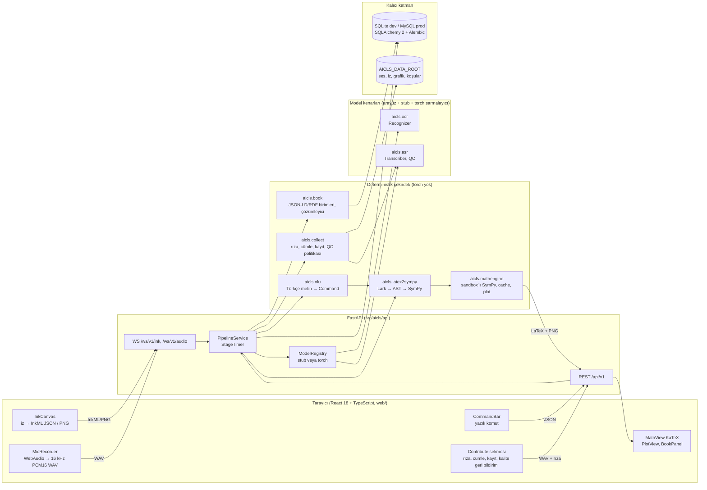
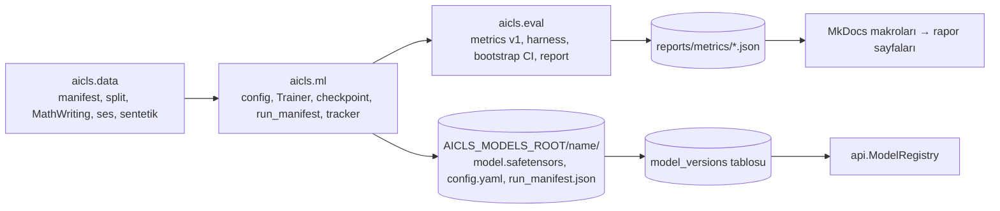

# Mimari Genel Bakış

Bu belge AI-CLS'nin bileşenlerini, veri akışını, modül sınırlarını, tam depo ağacını ve çalışma zamanı topolojisini tanımlar. Modül başına API imzaları için [moduller.md](moduller.md), uç noktalar için [api.md](api.md), tablolar için [veri-modeli.md](veri-modeli.md).

## 1. Bileşen diyagramı



Eğitim ve değerlendirme tarafı çalışma zamanı sürecinin dışındadır ve API'ye hiç import edilmez:



## 2. Veri akışı (uçtan uca)

### 2.1 Yazılı komut (deterministik yol, gecikme ölçümünün referansı)

```mermaid
sequenceDiagram
  participant B as Tarayıcı
  participant A as api.routers.compute
  participant P as PipelineService
  participant N as nlu.resolver
  participant L as latex2sympy
  participant M as mathengine.sandbox
  B->>A: POST /api/v1/compute/text {text:"x karenin türevini al"}  (t0 istemci)
  A->>P: run_text(text, ctx, user)
  P->>N: parse_command(text, context)   [stage nlu]
  N-->>P: Matched(Diff(expr="x^{2}", var="x"))
  P->>L: latex_to_sympy("x^{2}")          [stage parse]
  P->>M: execute(Diff(...), timeout=2.5)  [stage cas, ayrı süreç]
  M-->>P: Result(latex="2 x", kind="expr", timings)
  P-->>A: PipelineResult + timings
  A-->>B: 200 {result, command, timings}, Server-Timing: nlu;dur=..,parse;dur=..,cas;dur=..
  B->>B: KaTeX render (t1 istemci)
  B->>A: POST /api/v1/telemetry/latency {operation_id, client_total_ms, render_ms}
```

### 2.2 El yazısı (akışlı)

1. `InkCanvas` her kalem kaldırmada `{type:"stroke", seq, points:[{x,y,t}]}` gönderir; 400 ms kalem-boşta süresinden sonra sunucu `Recognizer.recognize()` çağırıp `{type:"partial", latex, confidence}` yayınlar.
2. Kullanıcı "tanı" dediğinde veya 1,5 s boşta kaldığında `{type:"final", latex, alternatives}`; arayüz `CommandPreview` ile LaTeX'i gösterir, kullanıcı onaylar; sonra yazılı komut yolu (2.1) çalışır (`context.last_latex` doludur, "türevini al" bu ifadeyi kullanır).
3. Girdi biçimi kararı ADR-0013: iz (InkML) birincil aday, PNG ikincil; her ikisi aynı `Recognizer` arayüzünden geçer.

### 2.3 Ses

1. `MicRecorder` tarayıcıda 16 kHz mono PCM16 WAV üretir (`web/src/lib/wavEncoder.ts`); sunucuda ffmpeg yoktur (ADR-0017).
2. Tek atış: `POST /asr/command` (WAV) → `Transcriber.transcribe()` → `nlu.parse_command` → CAS. Akışlı: `/ws/v1/audio` 250 ms parçalar, sunucu tarafında enerji tabanlı bitiş tespiti, `{type:"final", text}` ve ardından `{type:"command", command, latex_preview}`.
3. Ses modeli çıktısı hiçbir zaman doğrudan hesaplanmaz; NLU eşleşmesi yoksa `Clarification` (200, `kind:"clarification"`) döner.

### 2.4 Kitap içeriği

`"türev tanımını getir"` → `nlu` → `BookFetch(unit_type="Definition", query="türev")` → `book.resolver.resolve()` (normalize → `book_aliases` tam eşleşme → dizinli LIKE/FULLTEXT → difflib yeniden sıralama) → `ContentUnit` JSON-LD → `BookPanel` (KaTeX + şekil varlıkları).

### 2.5 Ses verisi toplama ("Model Gelişimine Katkıda Bulun")

Rıza metni sürümü kabul edilmeden kayıt uç noktası 403 `CONSENT_REQUIRED` döner → en az kaydedilmiş cümle önerilir (`collect.prompts.next_prompts`) → WAV yükleme → `asr.qc.run_qc()` (süre, kırpılma, SNR, sessizlik, DC ofset) eşzamanlı (< 300 ms) → kabul/red gerekçesi Türkçe → dosya `AICLS_DATA_ROOT/audio/raw/<speaker_pseudonym>/<ulid>.wav`; DB'de takma ad, demografik bant, rıza sürümü. Geri çekme: `POST /contribute/withdraw` ve `aicls contrib withdraw`.

## 3. Modül sınırları

Tek Python dağıtımı `aicls` (src düzeni), 14 alt paket. Bağımlılık yönü `import-linter` ile `pyproject.toml` içinde zorlanır ve `poe ci` ile CI'da çalışır.

```
katmanlar (üstteki alttakini import edebilir; aynı satırdakiler birbirini import edemez)
  cli
  api | ml
  eval
  data | collect | book
  nlu
  mathengine
  latex2sympy
  ocr | asr
  db
  core
```

Ek yasak sözleşmeleri:

| Sözleşme | Kural |
|---|---|
| `no-torch-in-core` | `aicls.core`, `aicls.db`, `aicls.latex2sympy`, `aicls.mathengine`, `aicls.nlu`, `aicls.book`, `aicls.collect`, `aicls.api` `torch`, `transformers`, `torchvision`, `peft` import edemez (ocr/asr içinde yalnızca `torch_recognizer.py`, `whisper_transcriber.py`, `wav2vec2_transcriber.py`, `models/*.py` tembel import eder). |
| `api-no-training` | `aicls.api` → `aicls.ml`, `aicls.eval`, `aicls.data` yasak. Modeller `aicls.api.model_registry` üzerinden `ocr.get_recognizer()` / `asr.get_transcriber()` ile yüklenir. |
| `nlu-no-db` | `aicls.nlu` → `aicls.db`, `aicls.book` yasak; kitap niyetleri `BookFetch` komutu olarak döner, çözümleme `api.services.pipeline` içinde yapılır. |
| `eval-no-ml` | `aicls.eval` → `aicls.ml` yasak (eğitici değerlendirmeyi kullanır, tersi değil). |
| `experiments-isolated` | `src/` hiçbir zaman `experiments/` import etmez. |

Her paketin sorumluluğu ve API'si [moduller.md](moduller.md) içindedir. Özet:

| Paket | Sorumluluk | İP |
|---|---|---|
| `core` | ayarlar, yollar, hata kodları, Türkçe kullanıcı mesajları, günlük, ULID, hash, zamanlayıcı, Türkçe metin yardımcıları, onay kapısı, LaTeX temizleyici | ortak |
| `db` | SQLAlchemy 2.0 modelleri, motor fabrikası, depo (repository) sınıfları, Alembic | İP-2/İP-8 |
| `latex2sympy` | LaTeX → AST → SymPy, kanonik yazıcı, gidiş-dönüş | İP-4 |
| `mathengine` | tipli komutlar, sandbox'lı SymPy yürütme, cache, adımlar, grafik, eşdeğerlik | İP-4 |
| `nlu` | Türkçe metin → niyet/yuva → Command; konuşulan matematik → LaTeX; açıklama isteme; yedek politika | İP-4 (raporlama) |
| `ocr` | InkML, iz özellikleri, raster, ön işleme (ablasyonlu), LaTeX tokenizer, model tanımları, `Recognizer` + stub + torch sarmalayıcı | İP-3 |
| `asr` | WAV okuma, log-Mel, artırma (SpecAugment, perde, gürültü, hız, TTS kancası), kalite denetimi, `Transcriber` + stub + Whisper/Wav2Vec2 sarmalayıcı | İP-3 |
| `book` | JSON-LD şeması, etiketleyiciler, kapsama doğrulayıcı, yükleyici, takma ad tablosu, sorgu, çözümleyici, JSON-LD/Turtle dışa aktarım | İP-8 |
| `collect` | rıza sürümleri, cümle dengeleme, kayıt kabulü, geri çekme, manifest dışa aktarım | İP-3 (veri) |
| `data` | veri manifestleri, deterministik bölmeler (konuşmacı/yazar-ayrık, tabakalı), MathWriting/ses/müfredat veri kümeleri, sentetik üreteçler, parça (shard) dönüştürme | İP-3 |
| `eval` | dondurulmuş metrikler ve normalizasyon sürümleri, değerlendirme koşumları, bootstrap güven aralıkları, rapor yazıcı | İP-3/4/8/9 |
| `ml` | eğitim yapılandırması, kayıt (registry), Trainer (OCR), Whisper ince ayar sarmalayıcısı (HF Seq2SeqTrainer), kontrol noktası, koşu manifesti, izleyici (tracker), profil koşusu, kuyruk | İP-3 |
| `api` | FastAPI uygulaması, yönlendiriciler, şemalar, güvenlik, WebSocket, PipelineService, model kaydı | İP-2 |
| `cli` | `aicls` komut satırı: serve, db, data, train (kapılı), eval, book, models, contrib, nlu, report | ortak |

## 4. Depo ağacı (tam)

```
ai-cls/
├── .gitattributes                      # mevcut: * text=auto eol=lf; png/jpg/wav/pt/safetensors binary; eklenecek: *.inkml text, *.jsonl text
├── .gitignore                          # /.venv*/, /data/, /runs/, /mlruns/, /site/, web/node_modules/, web/dist/, *.pt, *.ckpt, *.safetensors, .env, htmlcov/, .pytest_cache/, .mypy_cache/, .ruff_cache/, reports/tmp/
├── .editorconfig                       # utf-8, lf, 4 boşluk py / 2 boşluk ts,yaml,md
├── .pre-commit-config.yaml             # ruff, ruff-format, mypy (src), check-yaml/json, end-of-file, mixed-line-ending(lf), conventional-pre-commit, scripts/check_no_large_files.py, tools/lint_no_raw_sql.py
├── .python-version                     # 3.11
├── .env.example                        # tüm AICLS_* anahtarları açıklamalı (bkz. gelistirme/kurulum.md)
├── .vscode/settings.json               # yorumlayıcı C:\Users\cagri\.venvs\ai-cls, ruff, pytest
├── .github/
│   ├── workflows/ci.yml                # windows-latest + ubuntu-latest, Python 3.11: lint, type, import-linter, gates, tests, coverage gate, alembic, openapi drift, docs map, mkdocs --strict
│   ├── workflows/nightly.yml           # mysql:8 servisi (marker mysql), property 1000 örnek, perf bütçesi, Playwright 3 tarayıcı, pip-audit/npm audit, KaTeX render denetimi
│   ├── workflows/web.yml               # npm ci, eslint, prettier --check, tsc --noEmit, vitest, vite build, Playwright chromium
│   ├── workflows/docs.yml              # mkdocs build --strict; main'de yayın
│   ├── PULL_REQUEST_TEMPLATE.md        # testler, docs, ADR gerekli mi?, İP, OpenAPI yenilendi mi?, migrasyon incelendi mi?, kapıya dokunuldu mu?
│   ├── ISSUE_TEMPLATE/{bug.md,feature.md,experiment.md,adr-proposal.md}
│   └── CODEOWNERS                      # src/aicls/{latex2sympy,mathengine,book,collect,db} → mmturhan; {nlu,ocr,asr,data,ml,eval,core,cli} → csahin; web/, src/aicls/api → sguler (+ api/services için ikinci gözden geçiren csahin); docs/ → herkes
├── pyproject.toml                      # [project] aicls, dinamik sürüm; [tool.ruff] [tool.mypy] [tool.pytest.ini_options] [tool.coverage] [tool.importlinter]
├── poe_tasks.toml                      # Windows-önce görevler (kapılı görevler burada YOK)
├── requirements/
│   ├── base.in / base.txt              # çalışma zamanı (pip-compile --generate-hashes)
│   ├── dev.in / dev.txt                # geliştirme + test + docs + mlflow (saf Python)
│   ├── ml.in / ml.txt                  # KAPILI: torch cu128, torchvision, peft, accelerate
│   └── README.md                       # `poe lock` tek yenileme yolu
├── alembic.ini                         # script_location = src/aicls/db/migrations
├── mkdocs.yml                          # Material, language: tr, mkdocstrings, macros (reports/metrics), superfences mermaid, strict
├── README.md                           # 5 dakikalık Windows hızlı başlangıç (TR), docs'a bağlantı
├── CHANGELOG.md                        # Keep a Changelog, SemVer
├── LICENSE                             # yürütücü kararı bekliyor (ADR-0002'de not)
├── CITATION.cff
├── scripts/
│   ├── bootstrap.ps1                   # venv C:\Users\cagri\.venvs\ai-cls, pip-sync base+dev, pre-commit install, AICLS_DATA_ROOT oluştur, check_env
│   ├── bootstrap.sh                    # Linux VM eşdeğeri
│   ├── install_ml.ps1                  # KAPILI (CUDA_INSTALL): cu128 torch pin, get_device_capability()==(12,0) + bf16 matmul doğrulama, sürücü/araç takımı deftere yazılır
│   ├── dev_server.ps1                  # uvicorn --reload, .env yükler
│   ├── check_env.py                    # python/torch/cuda/gpu/sürücü, OneDrive yol uyarısı, disk, JWT sırrı varsayılan mı
│   ├── freeze_env.py                   # pip freeze + nvidia-smi + OS → JSON (run_manifest kullanır)
│   ├── new_adr.py                      # docs/adr/NNNN-slug.md şablondan
│   ├── new_experiment.py               # experiments/YYYY-MM-DD-slug/ NOTE.md + run.py
│   ├── release.py                      # sürüm artır, CHANGELOG, etiket
│   ├── db_seed_dev.py                  # demo kullanıcılar, çalışma alanı, örnek cümleler, mini kitap
│   ├── export_openapi.py               # docs/api/openapi.json + web/src/api/generated/schema.d.ts
│   ├── build_curriculum_testset.py     # datasets/curriculum/cards/*.yaml → problems.jsonl (srepr gidiş-dönüş + konu kotası doğrulama)
│   ├── make_synthetic_fixtures.py      # tests/fixtures/synthetic/* deterministik (seed 1234, < 2 MB)
│   ├── coverage_gate.py                # coverage.xml paket eşikleri
│   ├── check_no_large_files.py         # > 1 MB engel (datasets/, docs/assets/ hariç)
│   ├── sync_recordings.py              # toplama VM'inden iş istasyonuna çekme (robocopy/rsync over SSH) + VM'de temizleme
│   ├── backup_db.ps1 / backup_db.sh    # mysqldump / sqlite kopya + ses dizini, 30 gün rotasyon, şifreli
│   └── reproduce_report.ps1            # etiketli kontrol noktalarından rapora giren tüm değerlendirmeleri yeniden koşar
├── tools/
│   ├── check_docs_map.py               # docs/raporlama/ip-eslestirme.md satırlarındaki her yol var mı (CI)
│   ├── check_gates.py                  # scripts/, src/, training/ içinde urllib/requests/hf_hub_download/from_pretrained("hub-id")/weights= arama (CI)
│   ├── gen_erd.py                      # SQLAlchemy metadata → mermaid ERD → docs/mimari/veri-modeli.md bloğu
│   ├── lint_no_raw_sql.py              # sqlalchemy.text() + f-string yasağı (migrations hariç)
│   └── onedrive_setup.ps1              # web/node_modules junction, PYTHONPYCACHEPREFIX, git core.longpaths/fsmonitor
├── src/aicls/
│   ├── __init__.py                     # __version__
│   ├── py.typed
│   ├── core/
│   │   ├── settings.py                 # pydantic-settings Settings(AICLS_*), get_settings()
│   │   ├── paths.py                    # data_root(), models_root(), runs_root(), repo_root(), package_resource()
│   │   ├── logging.py                  # structlog JSON, request_id bağlama
│   │   ├── errors.py                   # AiclsError + ErrorCode(StrEnum)
│   │   ├── messages_tr.py              # kullanıcıya görünen tüm Türkçe metinler (sözleşmedeki "Bu problem tipi şu an için desteklenmemektedir." dahil)
│   │   ├── ids.py                      # ulid(), short_hash()
│   │   ├── hashing.py                  # sha256_file(), sha256_json(), fingerprint_jsonl()
│   │   ├── timing.py                   # StageTimer (bağlam yöneticisi, aşama → ms)
│   │   ├── turkish.py                  # tr_casefold(), tr_lower(), strip_diacritics(), ek tablosu
│   │   ├── gates.py                    # require_gate(name, cli_flag), GateError, onay defteri okuyucu
│   │   └── latex_safety.py             # sanitize_latex(): KaTeX öncesi izin listesi (\href, \url, \includegraphics yok)
│   ├── latex2sympy/
│   │   ├── grammar/latex_math.lark     # LALR, bağlamsal lexer
│   │   ├── grammar/commands.yaml       # desteklenen \komut → AST düğümü, Yunan harfleri, fonksiyonlar
│   │   ├── ast.py                      # dondurulmuş dataclass düğümler (span ile)
│   │   ├── parser.py                   # parse_latex(), LatexParser, önbellekli Lark
│   │   ├── transformer.py              # Lark Tree → AST
│   │   ├── to_sympy.py                 # AST → sympy.Basic, SymbolTable
│   │   ├── to_latex.py                 # AST → kanonik LaTeX
│   │   ├── printer.py                  # sympy_to_latex() (KaTeX uyumlu ayarlar)
│   │   ├── normalize.py                # boşluk, \left/\right, \dfrac→\frac, unicode → komut, tek eksik parantez onarımı (izli)
│   │   ├── roundtrip.py                # roundtrip_check()
│   │   ├── symbols.py                  # SymbolTable, varsayılan kabuller, ayrılmış adlar
│   │   └── errors.py                   # ParseError, UnsupportedConstruct, SemanticError
│   ├── mathengine/
│   │   ├── commands.py                 # Diff|Integrate|Limit|Solve|Simplify|Expand|Factor|Series|Evaluate|Plot (pydantic, ayırıcı alan op)
│   │   ├── engine.py                   # MathEngine.execute(cmd) → Result; dispatch, cache, unsupported politikası
│   │   ├── ops/{calculus,algebra,limits,series}.py
│   │   ├── steps.py                    # isteğe bağlı adım listesi (türev/integral kuralları)
│   │   ├── equivalence.py              # symbolic_equivalent() → 'equal'|'different'|'unparsable'
│   │   ├── plotting.py                 # Matplotlib Agg → PNG bayt, deterministik stil
│   │   ├── result.py                   # Result dataclass
│   │   ├── cache.py                    # LRU (kanonik LaTeX + komut anahtarı)
│   │   ├── sandbox.py                  # ısıtılmış spawn işçi havuzu, zaman aşımında kill+respawn, Job Object (Windows) / RLIMIT_AS (Linux) en-iyi-çaba
│   │   └── unsupported.py              # SymPy'ın çözemediği tipler → UnsupportedProblem
│   ├── nlu/
│   │   ├── inventory/commands.yaml     # komut envanteri (paket kaynağı, importlib.resources ile okunur)
│   │   ├── inventory/lexicon.yaml      # konuşulan matematik sözlüğü
│   │   ├── inventory/numbers.yaml      # Türkçe sayı sözcükleri
│   │   ├── inventory/schema.py         # Inventory pydantic doğrulaması
│   │   ├── normalizer.py               # ASR/yazılı metin → kanonik Türkçe (NLU'ya özel; WER normalizasyonu DEĞİL)
│   │   ├── numbers.py                  # to_number("yüz yirmi üç") → 123
│   │   ├── spoken_math/grammar.lark    # "x kare artı iki x" dilbilgisi
│   │   ├── spoken_math/parser.py       # spoken_to_latex()
│   │   ├── matcher.py                  # IntentMatcher: desen derleme, puanlama, top-k
│   │   ├── slots.py                    # SlotExtractor: EXPR, VAR, BOUNDS, POINT, DIRECTION, ORDER, UNIT_TYPE, QUERY
│   │   ├── mapper.py                   # niyet + yuvalar → mathengine.commands / BookFetch / UiAction
│   │   ├── resolver.py                 # parse_command() → Matched | Clarification | NoMatch
│   │   ├── fallback.py                 # IntentFallback Protocol; LlmIntentSuggester yalnızca niyet kimliği döner (varsayılan kapalı)
│   │   └── errors.py
│   ├── ocr/
│   │   ├── interfaces.py               # Recognizer Protocol, Recognition, Ink, Stroke, get_recognizer()
│   │   ├── inkml.py                    # InkML oku/yaz (defusedxml), Canvas JSON → Ink
│   │   ├── strokes.py                  # yeniden örnekleme, normalizasyon, delta/Bezier özellikleri
│   │   ├── render.py                   # iz → raster (deterministik, anti-aliased)
│   │   ├── preprocess.py               # ablasyonlu adımlar: gaussian_blur, laplacian_sharpen, grayscale, normalize01, resize_pad
│   │   ├── tokenizer.py                # LaTeX token sözlüğü (MathWriting normalize etiketleri)
│   │   ├── postprocess.py              # detokenize, parantez onarımı, dilbilgisi ön kontrolü
│   │   ├── models/{encoders,decoders,seq2seq}.py   # torchvision ResNet/EfficientNet/VGG (weights=None), StrokeTransformer/BiLSTM; LSTM/GRU/Transformer çözücüler; tembel torch
│   │   ├── decoding.py                 # greedy / beam
│   │   ├── stub.py                     # StubRecognizer (deterministik)
│   │   └── torch_recognizer.py         # TorchRecognizer (tembel import, ısıtma, beam)
│   ├── asr/
│   │   ├── interfaces.py               # Transcriber Protocol, Transcript, Audio, get_transcriber()
│   │   ├── audio_io.py                 # stdlib wave + numpy: PCM16 WAV oku, başlık doğrula, 44.1/48 kHz → 16 kHz windowed-sinc
│   │   ├── features.py                 # log-Mel (numpy; Whisper yolunda WhisperFeatureExtractor kullanılır)
│   │   ├── qc.py                       # run_qc(): süre, kırpılma, SNR, sessizlik, DC ofset → QcReport
│   │   ├── augment.py                  # spec_augment, pitch_shift, add_noise, speed_perturb, TtsAugmenter Protocol
│   │   ├── stub.py                     # StubTranscriber
│   │   ├── whisper_transcriber.py      # HF WhisperForConditionalGeneration.from_pretrained(local_dir) (tembel)
│   │   └── wav2vec2_transcriber.py     # Wav2Vec2 CTC alternatifi (İP-3 ensemble B planı)
│   ├── book/
│   │   ├── schema.py                   # ContentUnit, Triple, UnitType, Predicate (pydantic)
│   │   ├── context.jsonld              # @context (aicls:, schema:, skos:, dcterms:)
│   │   ├── vocab.ttl                   # RDF sözlüğü
│   │   ├── ingest/markdown_tagger.py   # "Tanım 1.1:" desenleri, ::: blokları
│   │   ├── ingest/latex_tagger.py      # \begin{tanim}[Ad]{id} ortamları
│   │   ├── ingest/validators.py        # coverage(): etiketsiz başlık → hata (İP-8 %100)
│   │   ├── loader.py                   # JSON-LD → DB upsert, LoadReport
│   │   ├── aliases.py                  # Türkçe ek tablosu ile takma ad üretimi (türev → türevi, türevin, türevini)
│   │   ├── query.py                    # search(): alias tam eşleşme → LIKE/FULLTEXT → difflib; get_unit, related
│   │   ├── resolver.py                 # resolve("türev tanımı", unit_type) → ResolvedUnit listesi, LRU
│   │   └── export.py                   # JSON-LD ve Turtle (rdflib) dışa aktarım
│   ├── collect/
│   │   ├── consent.py                  # rıza sürümleri, kabul kaydı, ip_hash
│   │   ├── prompts.py                  # okuma senaryoları, en az kaydedilmiş cümle dengeleme
│   │   ├── recordings.py               # kabul politikası (QC + rıza), dosya adlandırma, sha256
│   │   ├── withdrawal.py               # KVKK geri çekme: dosya + türev özellik silme, rıza denetim izi kalır
│   │   └── export.py                   # eğitim manifesti (yalnızca takma ad, qc_passed, rıza aktif), split dosyası
│   ├── db/
│   │   ├── base.py                     # DeclarativeBase, adlandırma kuralı, TimestampMixin, ULID PK tipi
│   │   ├── engine.py                   # make_engine(): sqlite (WAL, foreign_keys) / mysql (utf8mb4, pool_pre_ping)
│   │   ├── session.py                  # session_scope(), get_session()
│   │   ├── models/{user,workspace,operation,asset,recognition,transcript,consent,speaker,prompt,recording,book,model_version,eval_run,latency,feedback,audit}.py
│   │   ├── repositories/{users,workspaces,operations,recognitions,recordings,book,model_versions,eval_runs,latency,feedback,audit}.py
│   │   └── migrations/env.py, script.py.mako, versions/0001_initial.py ...
│   ├── api/
│   │   ├── app.py                      # create_app(settings); profil bazlı router bağlama; lifespan: sandbox havuzu, model kaydı
│   │   ├── deps.py                     # get_db, get_current_user, require_role, get_pipeline
│   │   ├── security.py                 # PyJWT HS256, argon2id, yenileme belirteci döndürme, ws-ticket
│   │   ├── middleware/{request_id,timing,security_headers,rate_limit,cors}.py
│   │   ├── errors.py                   # AiclsError → RFC 9457 problem+json
│   │   ├── schemas/{auth,users,workspaces,compute,ocr,asr,book,contribute,feedback,telemetry,admin,health,common}.py
│   │   ├── routers/{auth,users,workspaces,compute,ocr,asr,book,contribute,feedback,telemetry,admin,health}.py
│   │   ├── ws/{protocol,ink,audio}.py  # tipli zarflar (pydantic ayrımlı birlik), geri basınç
│   │   ├── services/{pipeline,compute,ocr,asr,book,contribute,history,telemetry}.py
│   │   └── model_registry.py           # model_versions tablosundan aktif modeli yükler; AICLS_MODELS_ENABLED=false → stub
│   ├── data/
│   │   ├── manifest.py                 # DataManifest.build/verify (dosya, boyut, sha256, lisans, kaynak, tarih)
│   │   ├── catalog.yaml                # veri seti/ağırlık adı → url, sha256, lisans, boyut, kapı adı
│   │   ├── splits.py                   # make_splits(group_key, stratify, ratios, seed) → Splits; mathwriting_official()
│   │   ├── shards.py                   # InkML → npz parçaları (memory-map), manifest
│   │   ├── mathwriting.py              # MathWritingDataset(root, split, mode='online'|'offline')
│   │   ├── audio_commands.py           # AudioCommandDataset (collect manifesti)
│   │   ├── curriculum.py               # load_curriculum(), Problem
│   │   ├── synthetic.py                # synth_ink, synth_image (mathtext), synth_audio, synth_inkml_dataset
│   │   └── collate.py                  # dolgu, maske, kovalama
│   ├── eval/
│   │   ├── metrics.py                  # cer, corpus_cer, wer, corpus_wer, exact_match, symbolic_equivalence, parse_success_rate, latency_stats, sus_score
│   │   ├── normalizers.py              # latex_v1, tr_v1 (sürümlü, dondurulmuş)
│   │   ├── bootstrap_ci.py             # 1000 yeniden örneklemeli %95 GA
│   │   ├── report.py                   # EvalReport modeli, write_report(), render_markdown()
│   │   ├── harness.py                  # EvalSpec → koşum seçici
│   │   └── parser_eval.py, cas_eval.py, nlu_eval.py, ocr_eval.py, asr_eval.py, book_eval.py, latency_eval.py
│   ├── ml/
│   │   ├── config.py                   # TrainConfig ağacı (pydantic, extra='forbid'), load_config(yaml, overrides), _base_ kalıtımı
│   │   ├── registry.py                 # MODELS/DATASETS/OPTIMIZERS kayıtları
│   │   ├── run_manifest.py             # RunManifest.capture(): git SHA, kirli bayrağı, diff hash, config hash, veri parmak izi, pip freeze, GPU/sürücü, adım hızı
│   │   ├── seed.py                     # seed_everything()
│   │   ├── env_capture.py              # capture_env() → env.json
│   │   ├── tracking/{base,jsonl,mlflow_}.py   # Tracker Protocol; JsonlTracker varsayılan; MlflowTracker opsiyonel
│   │   ├── trainer.py                  # Trainer (OCR seq2seq): bf16 autocast, grad accum, clip, cosine, eval, early stop, resume
│   │   ├── callbacks.py                # CheckpointSaver (atomik), EarlyStopping, LatencyProbe, InterruptSaver
│   │   ├── checkpoint.py               # dizin: model.safetensors, optimizer.pt, config.yaml, run_manifest.json, vocab.json, metrics.json
│   │   ├── optim.py                    # AdamW, warmup+cosine
│   │   ├── whisper_ft.py               # WhisperFineTuner: HF Seq2SeqTrainer sarmalayıcısı, compute_metrics→eval.corpus_wer, aynı manifest/checkpoint düzeni
│   │   ├── profile.py                  # 200 adımlık profil koşusu: adım/s, VRAM, dataloader bekleme %
│   │   ├── queue.py                    # training/queue.lock (git-ignore), tek iş, nvidia-smi denetimi
│   │   └── export.py                   # torchscript/onnx (sonraki faz)
│   └── cli/
│       ├── main.py                     # typer uygulaması `aicls`
│       └── {serve,db,data,train,eval,book,models,contrib,nlu,report}_cmd.py
├── training/
│   ├── configs/_base.yaml
│   ├── configs/ocr/{offline_resnet34_tfm,offline_effnet_b0_tfm,online_stroke_tfm,ablation_preproc,profile,smoke_synthetic}.yaml
│   ├── configs/asr/{whisper_small_ft,whisper_large_v3_turbo_lora,profile,smoke_synthetic}.yaml
│   ├── configs/sweeps/ocr_lr_sweep.yaml
│   ├── scripts/download_mathwriting.py # KAPILI (DATASET_DOWNLOAD)
│   ├── scripts/download_weights.py     # KAPILI (WEIGHTS_DOWNLOAD)
│   ├── scripts/prepare_mathwriting.py  # InkML → npz parçaları + manifest (kapı yok; yerel veri)
│   ├── scripts/prepare_audio_commands.py
│   ├── scripts/build_tokenizer.py
│   ├── scripts/train.py                # KAPILI (TRAINING); --synthetic her zaman serbest
│   ├── scripts/evaluate.py
│   ├── queue.txt                       # kilit düzeneğinin açıklaması (kilit: queue.lock, git-ignore)
│   └── README.md
├── models/registry.yaml                # tohum: `aicls models import` ile model_versions tablosuna
├── datasets/                           # git'e giren KÜÇÜK değerlendirme setleri (büyük veri AICLS_DATA_ROOT)
│   ├── README.md                       # kaynak, sürümleme, dondurma kuralları
│   ├── curriculum/cards/<topic>.yaml   # elle yazılan problem kartları
│   ├── curriculum/problems.jsonl       # derlenmiş ≥1000 problem
│   ├── curriculum/FROZEN.sha256        # status=frozen satırların parmak izi
│   ├── latex/valid_inputs.jsonl        # ayrıştırma başarı korpusu (≥2000)
│   ├── latex/unsupported.jsonl         # beklenen UnsupportedConstruct örnekleri
│   ├── nlu/commands_test.jsonl         # Türkçe komut → altın niyet/yuva
│   ├── nlu/asr_noisy_tr.jsonl          # ASR benzeri bozulmuş varyantlar
│   ├── nlu/reading_scenarios.yaml      # Okuma Senaryoları Kütüphanesi
│   ├── book/sample/*.md                # etiketli örnek bölüm
│   ├── book/expected_units.json
│   ├── book/fetch_test.jsonl           # komut → beklenen birim kimliği
│   └── manifests/{mathwriting.json,audio_commands.json,audio_commands_splits.json}
├── reports/
│   ├── metrics/*.json                  # makine yazımı değerlendirme sonuçları (git'te)
│   ├── metrics/latest.json             # `poe metrics-promote` ile güncellenen işaretçi
│   └── README.md
├── experiments/
│   ├── README.md
│   ├── _template/{NOTE.md,run.py}
│   └── 2026-09-online-vs-offline-ink/  # ilk planlı deneme (ADR-0013 girdisi)
├── tests/
│   ├── conftest.py
│   ├── fixtures/{inkml/,images/,audio/,latex/,book/,synthetic/}
│   ├── unit/{core,db,latex2sympy,mathengine,nlu,ocr,asr,book,collect,data,eval,ml,api}/
│   ├── property/{test_latex_roundtrip,test_nlu_normalizer,test_metrics_properties}.py
│   ├── integration/{api,db,ws,book,pipeline}/
│   ├── e2e/
│   ├── perf/test_latency_budget.py
│   ├── gated/test_gates.py
│   ├── gpu/test_cuda_smoke.py
│   └── data/                           # marker data
├── web/
│   ├── package.json                    # react 18, react-router 6, typescript, vite, katex, zustand, @tanstack/react-query, openapi-fetch, openapi-typescript, vitest, @testing-library/react, playwright, eslint, prettier
│   ├── vite.config.ts, tsconfig.json, .eslintrc.cjs, .prettierrc, vitest.config.ts, playwright.config.ts, index.html
│   ├── public/{favicon.svg,manifest.webmanifest}
│   ├── src/main.tsx, App.tsx, routes.tsx
│   ├── src/api/{client.ts,generated/schema.d.ts,ws.ts}
│   ├── src/app/{store.ts,auth.ts,theme.ts}
│   ├── src/features/workspace/{WorkspacePage.tsx,InkCanvas.tsx,StrokeBuffer.ts,InkToolbar.tsx,useInkSocket.ts}
│   ├── src/features/voice/{VoiceButton.tsx,Recorder.ts,useAudioSocket.ts}
│   ├── src/features/command/{CommandBar.tsx,CommandPreview.tsx}
│   ├── src/features/results/{ResultCard.tsx,MathView.tsx,PlotView.tsx,StepsView.tsx}
│   ├── src/features/history/HistoryPanel.tsx
│   ├── src/features/book/{BookPanel.tsx,BookUnitView.tsx}
│   ├── src/features/contribute/{ConsentForm.tsx,PromptCard.tsx,RecorderPanel.tsx,QcFeedback.tsx,ProgressBar.tsx}
│   ├── src/features/feedback/{FeedbackDialog.tsx,SusForm.tsx}
│   ├── src/features/admin/{ModelsPage.tsx,QcQueue.tsx,MetricsPage.tsx,UsersPage.tsx}
│   ├── src/components/ui/
│   ├── src/lib/{wavEncoder.ts,inkml.ts,latency.ts,latexSafety.ts}
│   ├── src/i18n/tr.json
│   ├── src/test/{setup.ts,InkCanvas.test.tsx,MathView.test.tsx,wavEncoder.test.ts,ws.test.ts}
│   └── e2e/{workspace.spec.ts,contribute.spec.ts,book.spec.ts,browsers.spec.ts}
├── deploy/
│   ├── docker-compose.yml              # profiller: full (api+mysql+caddy+web) / collect (api collect + mysql + caddy + web)
│   ├── Dockerfile.api, Dockerfile.web
│   ├── Caddyfile                       # TLS sonlandırma, HSTS, /api ve /ws proxy
│   ├── mysql/init.sql                  # veritabanı + en az yetkili kullanıcılar (aicls_app, aicls_ro, aicls_migrate)
│   ├── workstation/{install_service.ps1,nssm-aicls-api.xml,README.md}
│   ├── collect-vm/{docker-compose.yml,Caddyfile,.env.example}
│   └── backup/{backup.ps1,backup.sh}
└── docs/                               # bu site (Türkçe), bkz. index.md
```

## 5. Çalışma zamanı topolojisi

```mermaid
flowchart TB
  subgraph WS["İş istasyonu = İP-1 sunucusu (Windows 11; bugün RTX 5090 32 GB, satın alınan 16 çekirdek / 128 GB makine; 7/24, KGK)"]
    API1[uvicorn aicls.api profile=full<br/>NSSM Windows servisi, 127.0.0.1:8000]
    MYSQL1[(MySQL 8, utf8mb4)]
    CADDY1[Caddy: TLS, statik web/dist, /api ve /ws proxy]
    SB[SymPy sandbox havuzu, 2 işçi]
    GPU[GPU: eğitim kuyruğu tek iş<br/>veya çıkarım servisi]
    DATA[(AICLS_DATA_ROOT=D:\aicls-data<br/>ses, iz, koşular, mlruns, modeller)]
    API1 --> SB
    API1 --> MYSQL1
    API1 --> GPU
    API1 --> DATA
    CADDY1 --> API1
  end
  subgraph VM["Küçük VM (Ubuntu, 2 vCPU / 4 GB; üniversite VM'i ya da İP-1 B planı bulut VPS)"]
    CADDY2[Caddy: Let's Encrypt, ai-cls alan adı]
    API2[api profile=collect, docker compose<br/>auth, contribute, feedback, health]
    MYSQL2[(MySQL 8, yalnızca toplama şeması)]
    TMP[(kayıtlar: gece çekilene kadar)]
    CADDY2 --> API2
    API2 --> MYSQL2
    API2 --> TMP
  end
  U1[Sınıf / öğretim elemanı<br/>üniversite ağı] --> CADDY1
  U2[Gönüllü katılımcılar<br/>3 üniversite, internet] --> CADDY2
  TMP -. scripts/sync_recordings.py<br/>gece çek + VM'de sil .-> DATA
  CADDY2 -. /api/v1/compute* isteğe bağlı proxy<br/>üniversite portu açıksa .-> CADDY1
```

Kararlar ve gerekçeler (ADR-0018):

- **Tek kod tabanı, iki profil.** `AICLS_PROFILE=full` tüm yönlendiricileri; `AICLS_PROFILE=collect` yalnızca `auth`, `contribute`, `feedback`, `health` ve `admin` (QC kuyruğu) yönlendiricilerini bağlar. Aynı Alembic migrasyonları iki hostta koşar.
- **İş istasyonu = İP-1 sunucusu.** Satın alma şartnamesi (16 çekirdek AM5, 128 GB DDR5, 4 TB NVMe + 10 TB HDD, 1200 W, 3 kVA KGK, 7/24) tam olarak bu makinedir; üniversite ağına entegre edilir, üniversiteden alınan port ile dışa açılır. GPU aynı anda ya eğitim kuyruğunu ya da çıkarım servisini çalıştırır (`aicls.ml.queue` nvidia-smi ile denetler; eğitim sırasında `GET /health/ready` model bileşeni için 503 döner ve arayüz "model eğitimde" uyarısı gösterir; deterministik CAS yolu etkilenmez).
- **Küçük VM yalnızca toplama için.** Ham KVKK (Kişisel Verilerin Korunması Kanunu) kapsamındaki ses verisi halka açık hostta gece senkronizasyonuna kadar kalır, sonra silinir. VM Faz 0–1'de yoktur; toplama sekmesi yayına alınırken (etik kurul onayı dış bağımlılık) ve üniversite portu iş istasyonunu doğrudan dışa açmaya yetmiyorsa devreye alınır. Üç kişilik ekip için ek işletme yükü `deploy/collect-vm/docker-compose.yml` tek dosyası ve `sync_recordings.py` ile sınırlandırılmıştır. Hakem değerlendirmelerinde iki host konusundaki çekince (işletme yükü) bu sınırlamayla karşılanmıştır; VM'siz senaryoda `collect` profili iş istasyonunda ikinci bir uvicorn süreci olarak çalışır.
- **Geliştirici makinesi.** Bugünkü makine (RTX 5090, torch CPU derlemesi) = geliştirme + (kapı açılınca) eğitim. SQLite dev veritabanı `AICLS_DATA_ROOT/aicls-dev.db`.

## 6. Fazlar (özet; ayrıntı [gelistirme/is-akisi.md](../gelistirme/is-akisi.md) ve [raporlama/ip-eslestirme.md](../raporlama/ip-eslestirme.md))

| Faz | Tarih | Çıktı |
|---|---|---|
| 0 Sıfırlama | 2026-09-08 → 09-20 | depo iskeleti, pyproject, poe, pre-commit, CI, `aicls.core` + kapılar testli, MkDocs iskeleti + ADR-0001..0019, `v0.0.1` |
| 1 Deterministik çekirdek | 2026-09-21 → 11-01 (8. hafta) | Lark dilbilgisi v1 + gidiş-dönüş özellik testleri, mathengine (sandbox/cache/plot), 300 problemlik müfredat tohumu, NLU envanteri v1 (17 niyet, 300 altın cümle), db + Alembic + auth + workspaces + compute uçları, `CommandBar` + `MathView` + giriş, ML altyapısı sentetik veriyle CPU'da testli, ölçülmüş ayrıştırma/CAS/NLU/gecikme sayıları, `v0.1.0` |
| 2 Gerçek zamanlı girdi ve toplama | 2026-11 → 2027-01 | InkCanvas + StrokeBuffer + `/ws/v1/ink` (stub), Recorder + `/ws/v1/audio`, Contribute sekmesi (rıza/cümle/QC), kitap örnek bölümü + BookPanel, Playwright 3 tarayıcı, kapı talepleri yazılı (katalog girdisi, disk/süre tahmini), 6. hafta tablet deneyi → ADR-0013 kararı, `v0.2.0` |
| 3 Modeller (kapılara bağlı) | 2027-01 → 2027-04 | cu128 kurulum, MathWriting parçaları + manifest, 200 adımlık profil koşuları, OCR taban modelleri + ablasyon, whisper-small ince ayar (ekip kayıtları + TTS), model_versions kaydı, gerçek modellerle gecikme, `report-2027-05` etiketi, `reproduce_report.ps1` temiz klondan |
| 4 Ölçekleme ve dondurma | 2027-05 → 2027-08 | 3 üniversitede toplama, 200+ saat artırma, whisper-large-v3-turbo LoRA, OCR iyileştirme, niceleme, 2027-08-15 model dondurma, `v0.5.0` |
| 5 Pilot ve kesin rapor | 2027-09 → 2028-04 | İP-9 test raporları, SUS/geri bildirim uçları, iki iyileştirme döngüsü, `v1.0.0`, `report-2028-05` |

8. hafta sonunda gelişme raporuna girebilecek ölçülmüş sayılar: ayrıştırma başarısı ve CAS doğruluğu (300 problem), NLU niyet/yuva doğruluğu (300 cümle), örnek bölümde kitap getirme doğruluğu, deterministik yolun ortalama/p50/p95 gecikmesi, kapsam ve CI istatistikleri. Ekip literatür-önce çalıştığından bu faz küçük ama uçtan ucadır; MVP baskısı yoktur.
