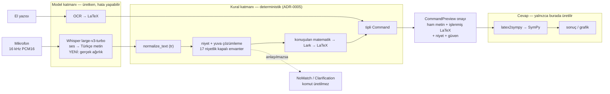

# Ses tanıma ve yerel dil modeli değerlendirmesi (İP-3 / İP-4)

- **Durum:** öneri — karar değil. Karar mercii: proje yürütücüsü ve AI eş güdümü.
- **Tarih:** 2026-09-08
- **Hazırlayan:** AI eş güdümü (dört ayrı literatür/depo taramasının sentezi)
- **Soru:** RTX 5090'a yerel bir dil modeli koyup konuşmayı hem yazıya dökmesi hem de anlaması,
  yorumu kullanıcıya onaylatıp sonra deterministik motora tipli komut vermesi mantıklı mı?
- **Kısa cevap:** Ses tanıma tarafı **evet, hemen** (ve bu bir dil modeli değildir). Anlama
  tarafına dil modeli **şimdilik hayır** — kalıcı olarak değil, ölçüm gelene kadar.
- **İlgili:** [ADR-0005](../adr/0005-metin-komut-katmani-ip4.md),
  [ADR-0012](../adr/0012-onay-kapilari.md), [ADR-0014](../adr/0014-gecikme-mimarisi-websocket.md),
  [ADR-0015](../adr/0015-metrik-tanimlari-dondurulmus.md),
  [ADR-0017](../adr/0017-ses-girdi-bicimi-wav.md),
  [ADR-0018](../adr/0018-calisma-zamani-topolojisi.md),
  [ADR-0020](../adr/0020-gpu-calisma-ortami-wsl-nvidia-docker.md),
  [mimari/metin-komut-katmani.md](../mimari/metin-komut-katmani.md),
  [güvenlik ve gizlilik §2](../guvenlik-gizlilik.md), [deneme alanı](../deneme-alani.md).

---

## 0. Yönetici özeti — sekiz cümle

1. Bu çalışmayı başlatan sayı (`join_words` doğruluğu **0,276**) artık geçerli değildir. Bu belgeyi
   hazırlarken projenin kendi ölçüm aracını kendim koşturdum: **0,9194**. Küme geneli **0,9913**.
2. 693 satırlık gürültülü kümede toplam **6 hata** var; **5'i güvenli başarısızlık** (sistem
   "anlamadım" diyor) ve **yanlış komut üreten tek satır bir `join_words` satırı bile değil**.
   Yani bir dil modelinin kazanabileceği toplam pay **6 satır / 0,87 puandır**.
3. "Yerel LLM koyalım" fikri aslında **iki ayrı soruyu** birlikte soruyor. Konuşmayı yazıya dökme
   sorusunun cevabı bir dil modeli değil, bir **ses tanıyıcıdır** (Whisper) — ve o zaten
   kararlaştırılmış, ağırlığı **indirilmiş**, sınıfı **yazılmış**, ama **hiç çalıştırılmamıştır**.
4. Anlama sorusunun cevabı bugün "hayır"dır: kazanç 6 satır, buna karşılık yayımlanmış düzeltici
   LLM'lerin bozma oranı bu kazancın **3,5–13 katıdır**. Başabaş bozma oranı **%0,873**; ölçülmüş
   LLM bozma oranları %3,1–%11,5.
5. Bu dönem eklenmesini önerdiğim şey bir model değil, **bir ölçümdür**: gerçek Türkçe sesle
   Whisper'ı bir kez koşturup hata dağılımını çıkarmak. Bugün projede tek bir gerçek Türkçe WER
   sayısı yoktur; mevcut ASR raporu bir dalga formunu özetleyip cümle seçen `StubTranscriber` ile
   üretilmiş bir **bağlantı denetimidir** (`reports/metrics/asr_test_60aad42.json`).
6. **ADR-0005 değişmiyor** ve bu, önerinin en güçlü tarafıdır (§3). Whisper ADR-0005'in
   *yukarısında* durur; ADR-0005 zaten bir ASR'nin varlığını varsayar ve onu deterministik saymaz.
7. Maliyet bu dönem neredeyse sıfırdır: **ağırlık zaten diskte** (`whisper-large-v3-turbo`,
   1,51 GiB, MIT, sha256 doğrulanmış), **onay kapısı zaten açık** (2026-09-08), yazılacak kod tek
   dosyada dört küçük yama artı iki betik. Tahmini **3–5 iş günü**.
8. Önce yapılması gereken şey kod değil, **bir sızıntıyı kapatmaktır**: bugünkü haliyle gerçek bir
   Whisper koşusu, geliştirme kümesinde ölçülmüş bir WER'i `reports/metrics/latest.json` içine
   **sözleşmedeki "WER < %10" hedefinin yanına** yazar. O yama sesten önce girmelidir (§7, Aşama 0).

---

## 1. Önce kayıt düzeltmesi: çalışmayı başlatan sayı artık doğru değil

Bu belgeyi hazırlarken projenin kendi ölçüm aracını (`tests/unit/nlu/metrics.evaluate`) kendi veri
kümeleri üzerinde, **CPU'da, GPU'ya dokunmadan** yeniden koşturdum. Sonuç:

| Küme | n | `intent_accuracy` | `slot_f1` | Açıklama isteği |
|---|---|---|---|---|
| `datasets/nlu/asr_noisy_tr.jsonl` | 693 | **0,9913** | 1,0000 | 0,0014 |
| `datasets/nlu/commands_test.jsonl` | 351 | **0,9972** | 1,0000 | 0,0000 |

Bozulma tipine göre (aynı koşu):

| Bozulma | n | doğruluk |
|---|---|---|
| `detach_suffix` | 120 | 1,0000 |
| `shorten_suffix` | 120 | 1,0000 |
| `insert_filler` | 150 | 1,0000 |
| `misspell` | 114 | 1,0000 |
| `drop_apostrophe` | 21 | 1,0000 |
| `capitalise` | 106 | 0,9906 |
| **`join_words`** | 62 | **0,9194** |

Kural katmanının maliyeti: **1,25 ms/cümle**, tek çekirdek.

Sayı 2026-09-07'de değişti: `Lexicon.resegment()` (`src/aicls/nlu/lexicon.py`) sözlük güdümlü
en-uzun-eşleşme ile birleşmiş sözcükleri yeniden kesiyor. `docs/mimari/metin-komut-katmani.md` §9.4
önce/sonra tablosunu (0,276 → 0,948, dondurulmuş 667 satırlık dosyada) kayda geçirmiş. Benim
ölçtüğüm 0,9194 ise yeniden üretilmiş 693 satırlık dosyadadır; iki sayı **farklı dosya
sürümlerinden** gelir ve ikisi de gerileme ölçümüdür. Rapora, hangi sayının hangi dosyadan geldiği
yazılmadan alınmamalıdır.

### 1.1 Kalan altı hata — tek tek

| id | metin | çıktı | sınıf |
|---|---|---|---|
| `inv-limit-04-n1` | `x sıfıra soldan yaklaşırken bir bölü x'inlimiti` | NoMatch | join_words; sınır kesme işaretinin arkasında |
| `inv-limit-08-n1` | `x eksi sonsuza giderken e üzeri x'inlimiti` | NoMatch | aynı |
| `inv-book_search-04-n2` | `kitaptasüreklilik ara` | NoMatch | join_words; sözlükte olmayan **arama terimi** |
| `rs-kitap_getir-15-n2` | `örnek 1.4'ügetir` | NoMatch | join_words; kesme + sayı |
| `rs-kitap_ara-11-n2` | `kitapta türev kurallarıara` | Clarification | join_words; arama terimi |
| `rs-kapsam_disi_matematik-01-n1` | `logaritma x Fonksiyonunun tanım kümesini söyle` | **`book_fetch`** | `capitalise`; **kapsam dışı istek komuta düştü** |

Bu tablo önerinin gerekçesini kökten değiştiriyor:

* **Beş hatanın beşi güvenli başarısızlıktır.** Sistem yanlış cevap vermiyor, "anlamadım" diyor.
  Sınıftaki bedeli, öğrencinin cümleyi tekrarlamasıdır.
* **693 satırda yanlış komut üreten tek satır vardır** ve o bir `join_words` satırı değil, bir
  **kapsam dışı** satırdır. Yani bugün projedeki tek gerçek "yanlış cevap" riski bir dil modelinin
  çözeceği sınıfta değil, **reddetme eşiğindedir**. Aynı hata temiz kümede de var
  (`rs-kapsam_disi_matematik-01`), yani bozulmayla ilgisi bile yok.
* Kalan `join_words` hatalarının hepsi **tek bir tanımlı sınıftadır**: birleşen parçalardan biri
  sözlükte olmayan bir *serbest metin* terimi ("süreklilik", "kurallar", "1.4") ya da sınır bir
  **kesme işaretinin arkasındadır**. Bu §9.5'te zaten bilinçli bir sınır olarak yazılıdır.

**Sonuç:** bir dil modelinin bu kümede kazanabileceği en fazla şey 6 satırdır (0,87 puan). Buna
karşılık kaybedebileceği pay 687 satırdır. Başabaş bozma oranı **%0,873**. Serbest üretimli
LLM'lerin ASR düzeltmesinde yayımlanmış bozma oranları: Llama-8B %3,1, Llama-70B %4,6, Mistral-7B
%11,5; ve zaten doğru olan bir çıktıda (%2,2 WER) en iyi model WER'i %8,8'e çıkarmıştır
(arXiv 2405.15216). Yani **bugünkü kümede beklenen etki negatiftir**.

!!! warning "Rapora giderken"
    2027-05-01 ara raporunda ve ekip sunumlarında 0,276 sayısı **artık kullanılmamalıdır**. Sayının
    kendisi doğruydu; katman değişti. Bir dil modeli önerisi 0,276 üzerine kurulursa, harness'i
    yeniden koşturan bir hakem çözülmüş bir problemin savunmasını okuyacaktır.

### 1.2 Bu ölçüm neyi ölçmüyor?

Deponun kendi uyarısı (`datasets/nlu/README.md`, "Kaynak/provenans uyarısı"): bu üç dosyanın
tamamı **proje ekibince yazılmıştır**, bağımsız test kümesi değildir, ve gürültülü kümedeki
**bozulma karışımının ağırlıkları bir ölçüm değil varsayımdır**. Yani:

> Gerçek bir Türkçe ses tanıyıcının hatalarının yüzde kaçı "sözcük birleşmesi"dir? **Bilmiyoruz.**

62/693 oranı bizim varsayımımızdır, gözlemimiz değil. Bu belgedeki bütün kararlar bu tek
bilinmeyene bağlıdır ve §5'teki ölçüm planı tam olarak onu ölçmek için vardır.

---

## 2. Ne ekliyoruz ve boru hattında nerede duruyor?

### 2.1 Sorunun ikiye ayrılması

"Yerel bir LLM koyalım" cümlesi iki farklı soruyu birlikte soruyor; bunlar ayrılmadan karar
verilemez:

| | Soru | Bileşen | Cevap |
|---|---|---|---|
| **(a)** | Konuşmayı Türkçe metne kim çevirecek? | **Ses tanıyıcı** (Whisper). Bir dil modeli **değildir**: ses→metin çevirir, akıl yürütmez, komut seçmez. | **Evet, hemen.** Zaten planda, zaten indirilmiş, hiç çalıştırılmamış. |
| **(b)** | Metni komuta kim çevirecek? | **Kural katmanı** (`aicls.nlu`), ADR-0005. Buraya bir dil modeli sokmak yeni bir karardır. | **Şimdilik hayır.** Kazanç 6 satır, risk 687 satır (§1). |

Bu ayrım önemlidir, çünkü **(a) yeni bir mimari değildir**. `src/aicls/asr/` altında 13 modül ve
`WhisperTranscriber` sınıfı zaten yazılıdır; `/ws/v1/audio` akışı, QC, WAV giriş/çıkışı ve
değerlendirme koşucusu hazırdır. Bugün platformun tamamı `StubTranscriber` ile çalışıyor: bir dalga
formunun özetini alıp 12 tohum cümleden birini seçen deterministik bir taklit. **Bu dönemde
yapılacak iş, plana bir şey eklemek değil; planın hiç koşturulmamış yarısını koşturmaktır.**

### 2.2 Boru hattı ve sınır



Okunması gereken tek cümle: **kural katmanından itibaren hiçbir kutuda dil modeli yoktur.** Whisper
yalnızca Türkçe metin üretir; niyeti kural katmanı seçer, LaTeX'i Lark dilbilgisi kurar, cevabı
SymPy hesaplar. Bir ses tanıma hatası **yanlış bir cevaba** değil, **yanlış bir soruya** ya da
"anlamadım"a yol açar. Bu ayrımı §6.1'de dürüstçe açıyorum, çünkü A.2.2 cevabı korur, soruyu değil.

### 2.3 Bu dönem tam olarak ne ekleniyor?

1. `whisper-large-v3-turbo` ağırlığının **gerçekten yüklenmesi** (dosya zaten diskte).
2. `src/aicls/asr/whisper_transcriber.py` içinde **dört küçük yama** (§4.4) — biri (halüsinasyon
   eşikleri) doğrudan A.2.2 iddiasını taşır.
3. **Bir Türkçe geliştirme kümesi:** ekipten 3–4 kişinin `datasets/nlu/reading_scenarios.yaml`
   içindeki 288 cümleyi okuması (~40 dakika ses, bir öğle sonrası).
4. **Bir ölçüm koşusu ve bir hata histogramı** (§5).

Eklenmeyenler: dil modeli yok, yeni bağımlılık yok, yeni servis yok, bulut yok;
`AICLS_LLM_FALLBACK` hâlâ `false`.

---

## 3. ADR-0005 değişiyor mu? **Hayır.**

Bu bölümü, hakem sorduğunda cevabın hazır olması için cümle cümle yazıyorum.

### 3.1 Neden değişmiyor

ADR-0005'in konusu **metin→komut katmanıdır**, ses tanıma değil. ADR zaten "İP-3 (ASR çıktısının
tüketicisi)" diyerek yukarısında bir ses tanıyıcının var olduğunu varsayar ve onu deterministik
saymaz. Whisper o varsayımın gerçekleşmesidir, ihlali değil.

Kararın metnindeki taahhütleri tek tek denetledim; **hiçbiri değişmiyor**:

| ADR-0005 cümlesi | Durum | Neden |
|---|---|---|
| "`Matched \| Clarification \| NoMatch` çıktısı" | değişmiyor | Whisper metin verir; çözümlemeyi yine kural yapar. |
| "ses modalitesinde arayüz her zaman `CommandPreview` onayı ister" | değişmiyor | Onay, ses yolunun zaten var olan davranışıdır; gerçek Whisper onu daha da gerekli kılar. |
| "`IntentFallback.suggest()` yalnızca envanter niyet kimliği döndürebilir, ifade/sonuç üretemez" | değişmiyor | Bu mekanizmaya dokunmuyoruz; **açmıyoruz** da. |
| "`AICLS_LLM_FALLBACK=false` varsayılan" | değişmiyor | Aynı kalıyor. |
| "LLM kaynaklı çözümler `nlu_source=llm` ile ayrı sütunda raporlanır" | değişmiyor | Bu dönem `nlu_source` her satırda `rules`. |
| "bilinmeyen niyet SymPy'a ulaşamaz" | değişmiyor | Whisper niyet üretmez, yalnızca metin. |
| "NLU normalizasyonu … WER normalizasyonundan ayrıdır (ADR-0015)" | değişmiyor | İki normalizasyon ayrı kalıyor; gerçek WER ölçüldüğünde ADR-0015'in `tr_v1` sütunu ilk kez gerçekten kullanılacak. |

**"Halüsinasyon üretmez" iddiası (A.2.2) neden ayakta kalıyor:** iddia *sonucun* SymPy'dan
gelmesidir. Whisper sonuç üretmez, LaTeX üretmez, niyet seçmez, SymPy çıktısını görmez. Projede
*başka bir üretken model* (OCR) zaten aynı konumda duruyor ve iddiayı bozmuyor; Whisper onunla
tamamen aynı hukuki konumdadır. Katman sınırı `pyproject.toml` içindeki `no-torch-in-core` import
sözleşmesiyle **makine tarafından** korunuyor: `aicls.nlu` torch/transformers import edemez.
Whisper `aicls.asr` içindedir, yani sınırın doğru tarafında.

### 3.2 Ne zaman yeni bir ADR gerekir?

Deponun kuralı: kabul edilmiş bir ADR düzenlenmez, yerine **yeni kayıt** eklenir. İki durumda yeni
bir ADR gerekir ve **ikisi de bu dönemin dışındadır**:

1. **`AICLS_LLM_FALLBACK` üretimde açılırsa.** Bu, ADR-0005'in kendi öngördüğü bir düğmedir; ama
   açılması bir ADR değişikliği değil, ölçümle gerekçelendirilmesi gereken bir *işletim kararıdır*.
   Uyarı: §1.1'e göre bu düğmenin ölçülen tavanı **sıfır çalıştırılabilir komuttur** — beş
   `join_words` hatası doğru niyet verilse bile yuva çıkarılamadığı için `Clarification`a düşer.
   Daha iyi bir *soru* üretir ("Hangi ifadenin limitini alayım?"), daha çok *cevap* üretmez.
2. **Metin ile `parse_command` arasına üretken bir model konursa** — Aşama 2'nin koşullu seçeneği:
   yalnızca boşluk ekleyebilen, kısıtlı çözümlemeli bir "transkript onarıcı". O model `aicls.asr`
   içinde, ADR-0005 sınırının yukarısında dururdu; yani **ADR-0005 yine değişmezdi**. Ama bugün
   hiçbir ADR üretken bir modelin transkripti yeniden yazmasına izin vermiyor, dolayısıyla yeni bir
   kayıt gerekirdi.

O gün gelirse başlığı şimdiden şudur. Bugün yazılması **erkendir**, çünkü kararı verecek ölçüm
henüz yoktur:

> **ADR-0021: Transkript onarımı — yalnızca sözcük sınırı, dilbilgisiyle kısıtlanmış çözümleme,
> `aicls.asr` içinde; ADR-0005 sınırı değişmez.**
> Karar cümlesi şu olurdu: *"Model çıktısı, girdiye boşluk ve kesme işareti dışında karakter
> bazında özdeş olmak zorundadır; bu hem çözümleme maskesiyle hem de kodda bir son-koşul
> doğrulamasıyla iki kez zorlanır, ihlalde ham transkript geçer."*

**Bu belgeyle birlikte `docs/adr/0021-*.md` yazılmamıştır ve bu bilinçlidir.** Bu depoda ADR bir
*karardır*; "değişiklik gerekmiyor" bir karar değil bir bulgudur ve yeri burasıdır. ADR numarasını
bugün harcamak, Aşama 2 gerçekten bir karar ürettiğinde kullanılacak numarayı boş bir kayda vermek
olurdu.

---

## 4. Maliyet

### 4.1 Ağırlıklar — kritik düzeltme

Elimdeki dört rapordan ikisi "onay defteri boş, `WEIGHTS_DOWNLOAD` satırı açılmalı" diyor.
**Bu artık doğru değildir.** `docs/gelistirme/onay-defteri.md` denetlendiğinde:

* `WEIGHTS_DOWNLOAD` kapısı **2026-09-08'de onaylanmıştır** ve kapsamı aynen "ses tanıma ve yerel
  dil modeli değerlendirmesi kapsamında, hedef `D:\aicls-data\models\pretrained`" — yani tam olarak
  bu çalışma.
* `whisper-large-v3-turbo` **zaten indirilmiştir**:
  `D:\aicls-data\models\pretrained\whisper-large-v3-turbo`, 27 dosya, 1.622.467.428 bayt
  (1,51 GiB), dosya bazında sha256 taşıyan `manifest.json`, dizin parmak izi
  `sha256:f38440a9…c92b4`. `catalog.yaml` girdisi doldurulmuştur.

| Ağırlık | Boyut | Lisans | Durum | Ne için |
|---|---|---|---|---|
| `openai/whisper-large-v3-turbo` | 1,51 GiB | **MIT** | **diskte** | Birincil aday; kararı bu verecek. |
| `openai/whisper-large-v3` | ~3,1 GB | **Apache-2.0** | indirilmedi | **Doğruluk referansı**: turbo'nun bize kaç puana mal olduğunu *bizim* kümemizde görmek için. Aynı kod yolu, tek yapılandırma satırı. |
| `wav2vec2-xls-r-300m` | ~1,2 GB | Apache-2.0 | indirilmedi | Zaten katalogda (İP-3 B planı). §6.1'de bir kullanımı var; bu dönem gerekmez. |

**Lisans notu, altı çizilerek:** ASR tarafında lisans engeli yoktur (MIT / Apache-2.0) ve bu OCR
tarafındaki durumdan farklıdır — MathWriting CC BY-NC-SA 4.0'dır, yani ticari/patent aşamasına
doğrudan taşınamaz. **Projeye ikinci bir NC bağımlılığı girmemelidir.** Taramalarda çıkıp bu kurala
takılanlar: Meta MMS (CC-BY-NC-4.0), Coqui XTTS-v2 (ticari olmayan), `facebook/mms-tts-tur`
(CC-BY-NC), Piper'ın `tr_TR-dfki-medium` sesi (CC BY-NC-SA 4.0) — ve sinsi olanı: Khan Academy
Türkçe korpusuyla eğitilmiş "MIT" etiketli bir Whisper ince ayarı. **Ağırlığın lisansı temiz
görünse de eğitim verisi NC ise soru kapanmamıştır.**

### 4.2 VRAM

| | Tahmin | Kaynağı |
|---|---|---|
| turbo ağırlıkları (fp16) | ~1,6 GB | parametre sayısından (809M × 2 bayt) |
| çalışırken toplam (batch 1) | **~2,5–3 GB** | ara aktivasyonlar dahil — **tahmin** |
| large-v3 karşılaştırma | ~3,1 GB / çalışırken ~5 GB | aynı yöntem |

32 GB'lık kartta, üstelik eğitim koşusuyla paylaşarak, bu rahat sığar. **Bu bir tahmindir, ölçüm
değildir**; ilk koşuda `peak_vram_mb` ile ölçülüp bu tabloya yazılmalıdır.

### 4.3 Gecikme ve 3 saniyelik bütçe — burada dürüst olmak zorundayım

ADR-0014 bütçesi: OCR ≤ 800 ms, **ASR ≤ 1200 ms (5 s ses)**, CAS ≤ 150 ms, nlu ≤ 50 ms,
ayrıştırma ≤ 10 ms, **toplam ortalama < 3000 ms**.

| Koşul | Beklenti | Güven |
|---|---|---|
| 3–6 s'lik komut, kart boştayken | 150–350 ms | **Tahmin.** L4 üzerinde ölçülmüş 28–45× gerçek-zaman katsayısının donanım oranıyla (5090 ≈ 2–4× L4) ölçeklenmesi. |
| Aynı komut, eğitim koşusu kartta iken | 0,4–1,2 s | **Zayıf tahmin.** Zaman dilimlemesi öncelik tanımaz. |
| RTX 5090 için yayımlanmış Whisper sayıları | 6,5× ile 25× arası | Bu 4 katlık fark, **yapılandırmanın donanımdan baskın olduğunun kanıtıdır**. |

**Söz veremeyeceğim şey budur.** Hiçbir 5090 gecikme sayısı, `scripts/bench_asr.py` bu makinede iki
kez (boş kart / eğitim altında) koşturulmadan ne bu belgeye ne de rapora yazılmalıdır. Bildiğim tek
yapısal gerçek: Whisper her sesi **30 saniyelik pencereye doldurur**, yani 32 katmanlı kodlayıcı
maliyeti 2 saniyelik komut için de 30 saniyelik kayıt için de aynıdır; turbo yalnızca çözücüyü
(32 → 4 katman) ucuzlatır. Bu yüzden kart paylaşılırken turbo doğru varsayılandır.

**Kritik ortam kısıtı (dört raporda da eksikti):** Windows sanal ortamındaki torch `2.11.0+cpu`
sürümüdür ve kartı süremez (ADR-0020). GPU yolu **yalnızca WSL2 konteynerindedir**
(`codex-research-cu130`, torch 2.9.1+cu130, transformers 4.57.6). Yani ASR koşusu konteyner içinde
planlanmalıdır; Windows tarafında yalnızca CPU ile küçük model denemesi mümkündür.

### 4.4 Yazılacak kod

| # | İş | Dosya | Süre | Neden |
|---|---|---|---|---|
| 0 | **Sızıntı yaması** — `run_asr_eval` geliştirme/sentetik korpusta `breakdown["wiring_check"] = assess_wiring_check(synthetic_data=True)` yazsın; iki test | `src/aicls/eval/runners.py` | 0,5 gün | §6.5. **Sesten önce girmeli.** |
| 1 | dtype + dikkat: `from_pretrained(..., torch_dtype=float16, attn_implementation="sdpa")`; CPU'da fp32 kalsın | `src/aicls/asr/whisper_transcriber.py` | 0,5 gün | Bugün dtype verilmiyor → fp32 yükleniyor: iki katı VRAM, yarısı hız. |
| 2 | alan yanlılığı: `processor.get_prompt_ids(...)` ile `prompt_ids`; istem **envanterden ve sözlükten türetilsin** (elle liste değil), ≤ 224 belirteç | aynı dosya | 0,5 gün | "türev", "integral", "limit", "karekök" gibi terimlere yanlılık; rakam yerine yazıyla sayı. |
| 3 | **halüsinasyon eşikleri**: `no_speech_threshold`, `logprob_threshold`, `compression_ratio_threshold`, sıcaklık geri çekilmesi; eşik altında **boş metin + güven 0** | aynı dosya | 0,5 gün | Bugün çıplak açgözlü çözümleme var, eşik yok; `/ws/v1/audio` QC koşturmuyor. Öksürük → akıcı uydurma Türkçe → `parse_command`. **A.2.2 için taşıyıcı.** — **KISMEN YAPILDI (2026-09-09), ve bir varsayımı çürüttü:** `logprob` ve `compression_ratio` eşikleri girdi; `no_speech` **bu kontrol noktasından kurulamıyor** (aşağıya bakın). |
| 4 | 30 s: sessizce kırpmak yerine hata fırlat | aynı dosya | 0,25 gün | Üst katman zaten sınırlıyor; sessiz kırpma bir gün sessiz veri kaybına döner. |
| 5 | `scripts/build_asr_devset.py` — kayıtlardan manifest + konuşmacı-ayrık bölme | yeni | 1 gün | `run_asr_eval` bölme parmak izi olmadan sayı üretmeyi **reddediyor** (doğru davranış). |
| 6 | `scripts/bench_asr.py` — p50/p95, boş kart / yük altında | yeni | 0,5 gün | §4.3'teki tahminleri ölçüme çevirir. |
| 7 | hata tipi sınıflandırıcı (yerine koyma / silme / ekleme / **BİRLEŞME** / **BÖLÜNME**) | `experiments/` | 0,5 gün | §5.3 — **bu çalışmanın asıl ürünü.** |

**Toplam: 3–5 iş günü.** Yeni bağımlılık yok, `pyproject.toml` değişmiyor, kilit dosyası
yenilenmiyor, yeni servis ayağa kalkmıyor.

#### Madde 3'ün ölçülmüş düzeltmesi: `no_speech` bu modelde yok (2026-09-09, RTX 5090)

Bu tablo yazıldığında `no_speech_threshold`'un mevcut olduğu varsayılmıştı. Güvenilmeden önce
ölçüldü ve varsayım yanlış çıktı.

Gerçek `whisper-large-v3-turbo`, iki saniyelik **dijital sessizliğe** `"Altyazı M.K."` cevabını
veriyor — **güven 0,9668**. Sessiz gürültüye `"Evet."` diyor. Yazılan iki eşik de bunları
geçirir, üstelik doğru olarak: metin akıcı, tekrarsız Türkçe ve çözücü ondan emin.

Bu vaka için tasarlanan koruma Whisper'ın `no_speech` olasılığıdır. Belirteç kimliği doğru
çözülüyor (`<|nospeech|>` = 50363; `transformers`'ın kendi bulma yolu olan
`generation_config.no_timestamps_token_id - 1` de aynı sayıyı veriyor), ama saf sessizlikte o
pozisyondaki olasılık **0,00000000** — küçük bir sayı değil, sıfır. Pozisyona bir dil belirteci
değil `<|transcribe|>` hâkim (0,537). Yani `large-v3-turbo` bu sinyali hiç üretmiyor.

**Sonuç:** sessizlik koruması modelin çıktısından kurulamaz, **sesin kendisinden** kurulmalıdır.
`aicls.asr.qc` gereken ölçümlere (`silence_ratio`, `snr_db`) zaten sahiptir; onu canlı yola
bağlamak bu modülün değil **API sözleşmesinin** kararıdır, çünkü oradaki eşikler sesli okuma
yüklemeleri için ayarlanmıştır, kısa sesli komutlar için değil. Kararı ses yolunun sahibi
vermelidir.

### 4.5 Yazılmayacaklar ve nedenleri

* **`faster-whisper` / CTranslate2** — normalde en hızlısı; ama konteyner CUDA 13.0, CTranslate2
  tekerleri CUDA 12 + cuDNN 9 ve CUDA 13 desteği **açık bir konu** (OpenNMT/CTranslate2 #1933).
  Ayrıca ana hız kazancı olan INT8, Blackwell sm_120'de **kapatılmıştır**. Kurulu
  torch/transformers yığını bu kartta çalıştığı kanıtlanmış tek yoldur. *Önce sayıyı alalım.*
* **Qwen3-ASR-1.7B** (Apache-2.0, yerel akış + yerleşik bağlam yanlılığı, ilk belirteç ~102 ms) —
  mimari olarak en ilginç ikinci aday; ama `transformers >= 5.13` istiyor, `pyproject.toml`
  `>=4.57,<5` pinliyor. Ana sürüm yükseltmesi OCR tarafını da etkiler: **ayrı bir ADR konusu**,
  ASR kararı değil. Üstelik Türkçe için yayımlanmış hiçbir WER'i yok.
* **NVIDIA Parakeet / Canary** — pazarlama "çok dilli" diyor, dil listesi **Türkçe içermiyor**
  (25 Avrupa dili). Bu taramanın en net "iddia ile liste uyuşmuyor" vakasıdır.
* **Bulut STT (Groq / OpenAI / Google / Deepgram)** — §6.6.

---

## 5. Ne ölçeceğiz, hangi kümede, hangi sonuç kararı değiştirir

Bu projede **ölçemeyeceğimiz bir değişiklik yapılmaz.** Aşağıdaki tablo koşudan önce yazıldığı
için, sonucun sonradan işe geldiği gibi yorumlanmasını engeller.

### 5.1 Ölçüm kümesi

Dört rapor burada ayrışıyor; tutumumu §8.2'de gerekçelendiriyorum. Seçim: **ekip kayıtları.**

* **Küme:** `datasets/nlu/reading_scenarios.yaml` — 288 Türkçe cümle, 19 senaryo, **zaten yazılı**
  ve **zaten altın niyetlere bağlı**. 3–4 ekip üyesi okur: ~40 dakika ses, bir öğle sonrası.
* **Neden bu:** cümleler NLU altın kümesiyle aynı olduğu için yalnızca WER değil, **uçtan uca
  `command_intent_accuracy`** çıkar; yani İP-2'nin "komutların > %95 iletilmesi" ölçütü ilk kez
  gerçek sesle görülür.
* **Hukuki konumu:** ekip üyesinin kendi rızasıyla verdiği ses, öğrenci verisinden **farklı bir
  hukuki nesnedir**. `docs/ml/veri-yonetimi.md` §4 bunu zaten öngörüyor: ayrı rıza,
  `AICLS_ENV=dev`, `source="internal"`, ve **raporlanan WER'e girmez**. `deneme-alani.md` içinde
  `2026-11-whisper-zero-shot-tr-math` (kapılı: ağırlık) olarak planlanmıştır; kapı artık açıktır.
  Öğrenci toplama uç noktası kullanılmaz (`AICLS_ETHICS_APPROVAL_REF` boşken 503 verir — **ve
  vermelidir**).
* **Adı:** `asr_devset_tr_2026.09`. Sözleşme kümesi değildir ve adı bunu söyler.

### 5.2 Ölçülecekler ve kararı değiştiren eşikler

| # | Ölçüm | **Tut** | **Bırak / yeniden düşün** |
|---|---|---|---|
| M1 | `wer_tr_v1` ve `wer_raw` (ADR-0015'in iki sütunu yan yana) | `wer_tr_v1 < 0,15` → sıfır-atış hat çalışıyor, İP-3 hedefi (< 0,10) erişilebilir görünüyor | `> 0,25` → sıfır-atış yetmiyor, İP-3 ince ayarı erkene alınmalı |
| M2 | **`command_intent_accuracy`** (uçtan uca: ses → SymPy'a giden niyet) | `> 0,90` → hat sınıfa çıkabilir | `< 0,80` → sorun ASR'de mi NLU'da mı, cevabı M3 verir |
| M3 | **Hata tipi histogramı**: yerine koyma / silme / ekleme / **BİRLEŞME** / **BÖLÜNME** | §5.3 | §5.3 |
| M4 | Gecikme p50/p95 — boş kart **ve** eğitim altında | p50 < 1200 ms (ADR-0014) → turbo kalır | p95 bütçeyi aşıyorsa: önce eğitimi mesai dışına al, sonra `faster-whisper` gündeme gelir |
| M5 | **Halüsinasyon**: 20 sessizlik/gürültü klibi | boş metin + güven 0 | boş olmayan metin → §4.4 #3 yaması yetersiz, tekrar |
| M6 | turbo ↔ large-v3 farkı, aynı kümede | fark < 1 puan → turbo kalıcı | fark > 3 puan → large-v3'e geç (yapılandırma değişikliği) |
| M7 | **Gerileme**: `asr_noisy_tr.jsonl` 693 satır | ≥ 0,9913 (bugünkü) | herhangi bir düşüş → yama geri alınır |

### 5.3 M3 bu çalışmanın asıl ürünüdür

Diğer altısı mühendislik denetimidir; **M3 yeni bilgidir** ve LLM sorusunu kapatır ya da açar:

* **BİRLEŞME hata kütlesinin %2'sinden azsa** → `join_words` gerçek bir ses tanıyıcının nadiren
  ürettiği bir hata kipidir, `asr_noisy_tr.jsonl`'deki 62/693 ağırlığı yanlış ayarlanmıştır ve
  **ADR-0005'in kural tabanlı tercihi ölçümle güçlenir**. LLM onarıcısı kalıcı olarak düşer;
  yerine bozulma ağırlıkları gerçek dağılıma göre yeniden üretilir.
* **BİRLEŞME hata kütlesinin %10'undan fazlaysa** → LLM önerisinin hedeflediği problem ilk kez
  **gerçek çözücü çıktısında ölçülmüş** olur ve Aşama 2 gerekçelenir.
* **Beklentim (yanlışlanabilsin diye yazıyorum):** birleşme neredeyse hiç görünmeyecek. Whisper
  güçlü bir iç dil modeliyle çözümler ve boşluklu Türkçe üretir; "xkareninturevinial" onun tipik
  çıktısı **değildir**. Bunun yerine baskın hata sınıfı **rakam ve sembol biçimlendirmesi**
  olacaktır: "2x üzeri 3", "x²'nin", "0'dan 1'e" — NLU'nun *yazıyla* sayı beklediği yerde. Bu sınıf
  bozulma kümesinde **hiç yoktur**, yani bugün ölçülmüyor bile. Doğruysa çözüm bir dil modeli
  değil, **bir istem satırı ve bir normalleştirici kuralıdır**.

---

## 6. Riskler

### 6.1 Onay yorgunluğu — eş güdümcünün güvendiği emniyet ağı

Bu, koordinatörün açıkça dayandığı mekanizmadır ve **sessizce çökmeye en yatkın olanıdır**.

**Kötü haber yerleşiktir.** Klinik karar destek sistemlerinde ilaç güvenliği uyarıları vakaların
**%46–96'sında** geçiliyor (van der Sijs ve ark., 2006 ve sonraki derlemeler). fMRI çalışmaları
(Anderson, Vance, Kirwan ve ark.) tekrarlanan bir uyarıya görsel merkezlerdeki tepkinin **ikinci
gösterimden sonra** çöktüğünü, uyum oranının bir hafta içinde eridiğini gösteriyor. Bir derste 200
kez gösterilen onay paneli **refleksle onaylanır**. Bu yalnızca güvenlik değil, **etik** bir
sorundur: yanlış komut refleksle onaylandığında günlükler "insan onayladı" der ve sorumluluk,
bilgi aktarılmadan öğretim elemanına devredilmiş olur. Ayrıca sözleşmedeki **SUS > 75** ölçütünü
doğrudan tehdit eder (8. madde "hantal", 4. madde "destek gerekir").

**İyi haber spesifiktir ve koordinatörün sezgisini bir noktada haklı çıkarır.** Lyell & Coiera'nın
sistematik derlemesi (JAMIA 2017) otomasyon yanlılığının **doğrulama maliyetiyle** birlikte
arttığını buluyor: makineyi denetlemek bilişsel olarak pahalıysa (mamografi, EKG) yanlılık
görünüyor, ucuzsa görünmüyor. **İşlenmiş matematik, var olan en ucuz doğrulamadır**: bir öğretim
üyesi `\frac{d}{dx}x^{2}` görüntüsüne bakıp bir saniyede söylediği şey olup olmadığını bilir. Yani
mevcut `CommandPreview`'un ham metin + **işlenmiş LaTeX** + tipli komut + niyet + güven göstermesi
kozmetik değil, **taşıyıcıdır**.

Önerdiğim dört değişiklik (hiçbiri bu dönemin işi değil, ama İP-9 öncesi kararlaştırılmalı):

1. **Onayı modaliteye değil belirsizliğe bağlayın.** Bugün `modality="voice"` her zaman soruyor.
   Makine zaten var: `CONFIRMATION_THRESHOLD = 0.8` ve tarayıcı başına "Sesli komutlarda bir daha
   sorma" kaçış kapısı. Değişiklik, eşiği *kaçış kapısının altındaki taban* değil *kuralın kendisi*
   yapmaktır; ve bilinen tehlikeli hâllerde yükseltmektir: `nlu_source=llm`, yıkıcı niyetler
   (`ui_clear`), `unaccounted_content` tetiklenen satırlar. **%15 çıkan ve her çıkışı bir şey ifade
   eden onay okunur; her seferinde çıkan okunmaz.**
2. **Farkı görünür kılın, komutu değil.** En çok yakalamamız gereken hata bir **yuva** hatasıdır —
   x olması gereken y, birinci olması gereken üçüncü türev. Bütün ifadeyi işleyip "farkı bul"
   demek yerine, güveni düşük olan ya da yeniden bölütlemeyle kurtarılan yuvayı vurgulamak,
   doğrulama maliyetini en ucuza indirmektir; Lyell & Coiera'nın kazancın olduğunu söylediği yer.
3. **Alışkanlığa karşı tasarlayın.** Aynı fMRI grubunun **çok biçimli uyarıları** (sunumu
   değiştirmek) üç haftalık saha çalışmasında erimeye ölçülebilir biçimde direndi. Panel dırdır
   etmemeli; **farklı şey ifade ettiğinde farklı görünmelidir**: "yüksek güven, koşacağım şey bu"
   için bir sunum; "bunu model önerdi" veya "burada bir sözcük sınırını ben kurtardım" için görsel
   olarak ayrışan bir sunum. Maliyeti sıfırdır ve literatürde alışkanlık erimesine karşı ölçülmüş
   etkisi olan tek müdahaledir.
4. **Ölçün.** `sus_responses` yanında **onaya kadar geçen süre** ve **onay/düzeltme oranı**
   kaydedilsin. Medyan süre bir saniyenin altına düşerse panel refleksle tıklanıyordur ve güvenlik
   değeri kurgudur — ve bunu İP-9 raporunda **kanaat değil veri** olarak söyleyebiliriz.

### 6.2 GPU'suz sınıf

ADR-0018 zaten karar vermiş: **eğitim sırasında iş istasyonu API'si deterministik yolu sürdürür**,
model çıkarımı `ready` ucunda `training` bildirir. Yani projenin kendi mimarisi model çıkarımını
"kart meşgulken kaybolan bileşen" ilan etmiştir. İki sonucu var:

* **Kural katmanı sınıfı tek başına taşıyabilmelidir.** Bugün taşıyabiliyor (0,9913). Bu bir
  eksiklik değil, **A.2.2 iddiasının savunulabilir olmasının nedenidir.**
* **Bir dil modelini taşıyıcı hâle getiren her tasarım, projenin belgelenmiş bir kararıyla
  çelişir.** Yerel LLM önerisi ancak "iyi hava bileşeni" olarak kabul edilebilir.
* Sunucusuz/ağsız bir sınıf (öğretim elemanının dizüstü bilgisayarı) somut bir gereklilik hâline
  gelirse cevabı `whisper.cpp`'dir (MIT, GGUF, CPU'da çalışır, Python/CUDA gerektirmez). Bugün
  yapılmamalı; **bozulmuş mod cevabı olarak haritada durmalıdır.**

### 6.3 Model sürümü altımızdan değişir

Bu risk bizde **zaten kapalıdır** ve bir üstünlüktür: `_backend.require_model_dir()` yalnızca yerel
dizinden yükler, `local_files_only=True` kullanılır, `tools/check_gates.py` kapılı modüller dışında
`from_pretrained("openai/` kullanımını **yasaklar**, `catalog.yaml` sha256 taşır, `manifest.json`
dosya bazında özet taşır. İndirilen ağırlık bit düzeyinde sabittir; sağlayıcı modelini güncellese
bile bizim sayımız değişmez.

Karşılaştırma: bulut STT'de model **sessizce** değişir. 2026'da ölçtüğünüz WER'i 2027'de yeniden
üretemezsiniz. Bu bir gizlilik sorunu değil, bir **bilimsel yeniden üretilebilirlik** sorunudur ve
bir TÜBİTAK çıktısı için tek başına yeterli gerekçedir.

Kalan gerçek sürüm riski **kütüphane** tarafındadır: `transformers` ana sürüm geçişi (4 → 5) OCR
tarafını, `aicls.ml.whisper_ft`'i ve ASR'yi birden etkiler. Bu bir ASR kararı değil, **proje çapında
bir ADR konusudur.**

### 6.4 Lisans

* ASR tarafı temizdir: MIT (turbo), Apache-2.0 (large-v3, wav2vec2). Ticari/patent aşamasına
  taşınabilir.
* Kural: **projeye ikinci bir NC bağımlılığı girmeyecek.** MathWriting yeterlidir; liste §4.1'de.
* **Eğitim verisi üzerinden bulaşma**, ağırlık lisansından daha sinsidir: "MIT" etiketli ama NC bir
  korpusla eğitilmiş bir ince ayar çözülmemiş bir hukuki sorudur. İP-3 korpusu derlenirken bu kural
  yazılı olmalıdır; Common Voice (CC0) temiz alternatiftir.
* Türkçeye özgü LLM aileleri (Trendyol-LLM, Turkish-LLaMA, Cosmos, Kanarya) **lisans nedeniyle**
  elenir: Llama-2/Llama-3 topluluk lisansları kullanım kısıtı taşır. Kalite tartışması gerekmez.

### 6.5 Ölçüm sızıntısı — sesten önce kapatılması gereken risk

Dört rapordan birinin en değerli bulgusu ve bu belgeye giren en somut kod isteği:

`EvalReport.wiring_check_verdict` bir koşuyu yalnızca `breakdown["stub"]` üzerinden "bağlantı
denetimi" sayıyor. Gerçek bir Whisper takıldığı anda koşu `stub=False` olur ve `promote()`
**gerçek görünen bir `asr.wer_tr_v1` değerini `reports/metrics/latest.json` içine yazar** — MkDocs
makroları da onu sözleşmedeki "**WER < %10**" hedefinin yanında gösterir. Oysa o sayı 3–4 ekip
üyesinin okuduğu 288 cümleden gelmiştir: öğrenci değildir, aksan çeşitliliği yoktur, sınıf gürültüsü
yoktur.

Mekanizma zaten mevcut ve doğru gerekçe kodu bile yazılı: `WIRING_SYNTHETIC_DATA` = "the corpus was
generated in-process, not the corpus the metric names". Eksik olan tek şey, `run_asr_eval`'in onu
geliştirme korpusunda **yazmasıdır**. Bu §4.4 #0 numaralı iştir ve **ilk ses kaydedilmeden önce**
girmelidir.

Varsayımsal bir risk değildir: depo bunu bir kez yaşadı (`ocr.cer = 0.0`, kendi cevap anahtarını
okuyan bir stub'dan). `wiring_check` mekanizması **zaten o yüzden** vardır.

### 6.6 Bulut STT — sorulmuştu; cevap hayır, ve para gerekçe değil

Dürüst olalım: **maliyet gerekçe değildir.** Üç üniversitelik bir pilot dönem kabaca 35 saat sestir
(3 × 40 öğrenci × 14 hafta × 15 komut × 5 s): Groq'ta ~1,4 $, OpenAI'de ~12,6 $, Google'da ~33,6 $.
On katına çıksa yılda 350 $'ın altındadır. Bunu böyle söylemek, asıl gerekçelerin gerçek olduğunu
gösterir:

1. **KVKK.** Öğrenci sesi kişisel veridir; ABD'li bir sağlayıcıya gönderilmesi **yurt dışına
   aktarımdır**. 7499 sayılı değişikliğin 2024-06-01'de yürürlüğe girmesinden bu yana yeterlilik
   kararı, bağlayıcı şirket kuralları veya **imzalanıp beş iş günü içinde Kurul'a bildirilen bir
   standart sözleşme** gerekir; bildirmemenin idari para cezası 50.000–1.000.000 TL. Bizim rıza
   tasarımımız (`guvenlik-gizlilik.md` §2) takma adlı **yerel** saklama, QC'den geçmeyen sesin
   **hiç diske yazılmaması** ve çalışan geri çekme sözü veriyor; hiçbiri üçüncü taraf API'sinden
   sağ çıkmaz.
2. **Tutarlılık.** ADR-0005 hemen aşağıdaki katman için ağ bağımlılığını zaten reddetti. Hemen
   yukarıdaki katman için kabul etmek tutarsızdır ve hakem bunu sorar.
3. **Çevrimdışı sınıf** yapı gereği imkânsızlaşır.
4. **Ücretsiz katmanlar hacimde değil, hız sınırında çöker.** Google ayda 60 dakika verir; 40
   kişilik tek bir oturum ~150 dakika üretir, yani ilk 25 dakikada biter. Groq'un hacmi bol ama
   **dakikada 20 istek** sınırı vardır: öğretim elemanı "hepiniz deneyin" dediğinde dakikada en
   fazla 20 öğrenci hizmet alır, gerisi 3 saniyelik bütçenin dışına kuyruklanır. **Demo için bile
   iyi bir seçim değildir** — toplantı odası ağı klasik bir demo çökme biçimidir ve kart zaten binada.

Meşru tek bulut kullanımı: **ekip seslerinin**, ekibin kendi rızasıyla, **tek seferlik** referans
transkripsiyonu — kendi WER hattımızın bağımsız bir uygulamayla aynı sonucu verdiğini denetlemek
için. Bu bir bileşen değil, bir **ölçüm hakemidir**. Kabul edilip edilmeyeceği §9'da açık sorudur.

### 6.7 Ölçümün altındaki varsayım

Bu belgedeki her doğruluk sayısı — benim koşturduklarım dahil — sentetik bir bozulma karışımından
gelir ve deponun kendisi ağırlıkların **varsayım** olduğunu yazıyor. Bugünkü sayılara dayanarak
"LLM gerekmiyor" demek savunulabilirdir; "**hiçbir zaman gerekmeyecek**" demek, gerçek kayıtlar
gelene kadar savunulabilir değildir. §5 tam olarak bu boşluğu kapatmak içindir.

---

## 7. Aşamalı plan

Her aşama kendi başına kullanılabilir bir şey üretir ve **sonrakine geçilmeden durdurulabilir**.

### Aşama 0 — bu hafta. GPU yok, kapı yok, indirme yok.

| # | İş | Çıktı |
|---|---|---|
| 0.1 | **Kaydı düzeltin.** 0,276 geçen her TÜBİTAK/ekip metni bugünkü sayılarla güncellensin (0,9194 / 0,9913); hangi dosya sürümünden geldiği yazılsın. | Sunuma girmeyecek yanlış bir gerekçe |
| 0.2 | **Sızıntı yaması** (§6.5) + iki test: `test_a_real_asr_run_on_a_devset_publishes_no_wer`, `test_devset_run_carries_the_synthetic_data_reason_code` | Gerçekleşemeyecek bir sızıntı |
| 0.3 | **Deterministik düzeltmeyi bitirin.** Beş `join_words` hatası tek sınıftır: (i) `resegment`, her parçası bilinen komut sözcüğü olduğunda **tek bir bilinmeyen parçayı** kabul etsin ve niyetin serbest metin yuvası olsun; (ii) yeniden bölütleme kesme işareti işlemesinden **sonra** koşsun ("x'inlimiti" tam olarak bunu kaybediyor); (iii) kitap dizini terimleri **yalnızca arama yuvasında** geçerli olacak şekilde sözlüğe girsin. Harness hazır: `tests/unit/nlu/test_resegmentation.py`. | Hedef: `join_words` > 0,97; diğer altı bozulmada gerileme yok. Mikrosaniyeler; VRAM yok, lisans yok. |
| 0.4 | **Tehlikeli tek satırı ele alın.** Yanlış komut üreten satır `capitalise`/kapsam dışıdır. Bu bir **reddetme eşiği** çalışmasıdır; 25 kapsam dışı satırda ölçülür (bugün 0,96). | 693 satırdaki tek gerçek yanlış-cevap riskinin kapanması |
| 0.5 | **Kayıt protokolünü yazın** (okuma listesi, ayrı rıza metni, `AICLS_ENV=dev`, `source="internal"`) ve ekipten 3–4 gönüllü ayarlayın. | Kart boşaldığı gün başlanabilir hazırlık |

**Aşama 0 burada durabilir** ve proje yine kazançlı çıkar: sayılar doğru, sızıntı kapalı, kalan
hataların çoğu deterministik olarak çözülmüş olur — bir dil modeli hiç konuşulmadan.

### Aşama 1 — OCR eğitim koşusu bittiğinde (kart boşaldığında)

| # | İş |
|---|---|
| 1.1 | §4.4'teki 1–4 numaralı Whisper yamaları ve testleri (CPU'da test edilebilir) |
| 1.2 | Ağırlığı içeri alın. **Önce karar gerekiyor:** `models/registry.yaml` şeması her kayıttan `run_manifest` ve `metrics_file` istiyor; bizim eğitmediğimiz bir üst-akış ağırlığı ikisini de veremez. Ya şemaya `source: upstream` eklenir ya da temel ağırlıklar kayıt dışında tutulur. **`aicls models import`'tan önce çözülmeli.** |
| 1.3 | Ekip kaydı: 288 cümle × 3–4 kişi ≈ 40 dakika. `scripts/build_asr_devset.py` ile manifest + konuşmacı-ayrık bölme. |
| 1.4 | `run_asr_eval` koşusu — WSL konteyneri içinde. M1, M2, M5, M7. |
| 1.5 | `scripts/bench_asr.py` **iki kez**: boş kart ve eğitim altında. M4. |
| 1.6 | **M3 hata histogramı** ve `tests/unit/nlu/perturb.py` ağırlıklarıyla karşılaştırma. |

**Çıktı:** projenin **ilk gerçek Türkçe WER sayısı**, ilk gerçek gecikme sayısı, ve varsayımın
yerine bir gözlem. `experiments/2026-XX-whisper-zero-shot-tr-math/NOTE.md` olarak kayda geçer.
**Aşama 1 de burada durabilir:** ses girişi çalışır, ölçülmüş ve doğru etiketlenmiş olur.

**Koşudan önce her iki sonucun yorumu NOTE.md'ye yazılır** ki sonuç sonradan işe gelene göre
yorumlanmasın.

### Aşama 2 — yalnızca Aşama 1 belirli bir sonuç verirse (koşullu, otomatik değil)

* **M3'te birleşme < %2 ise (beklentim):** LLM onarıcısı **kalıcı olarak düşer**. Yerine yapılacaklar
  deterministiktir: rakam/sembol için normalleştirici kuralları, envanterden türetilen Whisper
  istemi, ve `asr_noisy_tr.jsonl` ağırlıklarının gerçek dağılıma göre yeniden üretilmesi. Bu sonuç
  rapora **olumlu bir bulgu** olarak yazılır: ADR-0005'in kural tercihi ölçümle desteklenmiştir.
* **M3'te birleşme > %10 ise:** bir **deney** açılır (dağıtım değil): yalnızca boşluk ve kesme
  işareti ekleyebilen, dilbilgisiyle kısıtlanmış çözümlemeli bir onarıcı, `aicls.asr` içinde. Kabul
  kapıları koşudan **önce** sabitlenir:
  1. 62 `join_words` satırında tam kurtarma oranı **0,9194'ü geçmeli** (yerini alacağı deterministik
     taban);
  2. diğer 631 satırda bozma oranı **sıfır** olmalı — "düşük" değil, sıfır; kısıt bunu mümkün, koddaki
     son-koşul doğrulaması denetlenebilir kılar;
  3. 693 satırda uçtan uca doğruluk **yükselmeli** (başabaş bozma oranı %0,873);
  4. p50 **ve** p95 bütçe içinde, kart **yük altındayken**;
  5. sert **400 ms zaman aşımı**, aşımda ham transkript geçer; **düşünme kipi kapalı** (bir akıl
     yürütme izi tek başına 3 saniyelik ölçütü bozar);
  6. `transcript_repaired` bayrağı `nlu_source` sütununun yanına eklenir; yoksa ADR-0005'in kurduğu
     denetim izi sessizce kırılır.

  Aday model: Qwen3.5-4B (Apache-2.0, 4-bit, ~4 GB, düşünme kapalı). **Türkçe için yayımlanmış
  hiçbir değerlendirmesi yoktur**; karar bizim ölçümümüze dayanır, bir alıntıya değil. ADR-0021
  ancak o noktada yazılır.
* **Her iki dalda da reddedilen:** modelin *hangi komutun koşacağına* karar verdiği tasarım. Onay
  adımı bunu kurtarmaz — ses yolu **zaten her zaman** `CommandPreview` gösteriyor; yani böyle bir
  model bir güvence eklemez, var olan güvenceyi **tek bariyer** hâline getirir. Ve makul görünen
  yanlış bir komut makul biçimde işlenir: yorulmuş bir okuyucunun tam olarak geçirdiği durum.

### Aşama 3 — 2027, gerçek pilot verisi geldiğinde

1. **Common Voice tr** (CC0, ~130 saat, 1829 konuşmacı) `DATASET_DOWNLOAD` ile: dış karşılaştırma ve
   yayımlanmış sayılarla kıyaslanabilirlik. Okunmuş cümledir, dikte edilmiş matematik değildir — bu
   söylenerek raporlanır. CC0 olduğu için İP-3 ince ayarının **lisans temiz** korpusu da odur.
2. **İnce ayar, ama körlemesine değil.** Taramanın en somut uyarısı: Common Voice üzerinde naif
   Türkçe ince ayar alan dışında **kötüleştiriyor** (bir örnekte alan dışı kümede 8,85'e karşı
   ayarlanmamış turbo'nun 6,18'i; başka bir kümede 20,71'e karşı 12,17). Kural: her ince ayar,
   **tutulan alan dışı kümelerde sıfır-atış taban çizgisine karşı** değerlendirilir. Birleştirilmiş
   LoRA yaklaşımı (bir örneği beş kümenin ikisinde tabanı geçiyor) tam ince ayardan daha güvenli bir
   reçetedir.
3. **Farkı yayımlayın, sayıyı değil.** Ekip kayıtları ile gerçek öğrenci kayıtları **aynı
   cümlelerde** ölçülüp aradaki fark raporlanır. Bu fark, geliştirme kümesinin bizi ne kadar
   şımarttığını ölçer ve düşük kaynaklı ASR değerlendirmesinde **yayımlanabilir bir metodolojik
   sonuçtur**.
4. TTS (Piper, CC0 kaynaklı Türkçe sesler) ancak burada, **eğitim artırımı** olarak devreye girer
   (`data.augment.tts_ratio`) — **test bölmesine asla**; `test_tts_samples_never_in_test_split` bunu
   zaten yapısal olarak engelliyor.
5. Ancak bundan sonra konuşmacı-ayrık gerçek test bölmesi **sözleşmedeki sayıyı** üretir.

---

## 8. Dört raporun ayrıştığı yerler ve aldığım tutum

### 8.1 "Öneriyi başlatan sayı bayat mı?" — dördü de evet diyor

Dördü de bağımsız olarak `join_words`'ün artık 0,276 olmadığını buldu; ben de kendi koşumla
doğruladım (§1). **Tutum: bayat, ve bu bulgu bu çalışmanın en önemli çıktısıdır.**

### 8.2 Ölçüm kümesi: ekip kaydı mı, TTS mi?

* Bir rapor: ekibin `reading_scenarios.yaml`'ı okuması — bir öğle sonrası, kapı gerekmez, altın
  niyetlerle uçtan uca ölçüm verir.
* Başka bir rapor: Piper TTS ile 1.920 satırlık sentetik korpus — 3–4 iş günü, **yeni bir ADR**,
  **yeni bir kapı satırı** ve araç zincirine GPL bir ikili.

**Tutum: ekip kaydı, ve önce.** Gerekçeler: (i) daha hızlı ve daha ucuz; (ii) TTS çıktısı sinirsel
bir çözücü için **dağılım içidir**, yani ondan çıkacak WER gerçek WER'in gevşek bir alt sınırıdır ve
projenin ihtiyacı olan sayı bu değildir; (iii) TTS yolu iki yeni onay nesnesi (ADR + kapı) gerektirir,
ekip kaydı ise `veri-yonetimi.md` §4'te **zaten sanksiyonlanmıştır**; (iv) okunan cümleler İP-3 istem
sayfasının kendisi olur, yani iş iki kere yapılmaz.

**Ama o raporun en değerli bulgusu TTS değildir**: sızıntı yamasıdır (§6.5) ve o **her iki yolda da**
gereklidir, çünkü ekip kaydı da metriğin adlandırdığı korpus değildir. Bu yüzden Aşama 0'a alındı.
TTS'in kendisi Aşama 3'te, ince ayar artırımı olarak yerini korur.

### 8.3 Bir LLM onarıcısı yapılmalı mı?

* Bir rapor: evet, ama yalnızca boşluk ekleyebilen ve dilbilgisiyle kısıtlanmış biçimde; **ve henüz
  değil**.
* Başka bir rapor: hayır; kısıtlı çözümleme sahip olmadığımız bir problemi çözer, sahip olduğumuz
  semantik riske **tanımı gereği kördür**, ve modelin "anlamadım" diyebilme yeteneğini yapısal
  olarak yok eder.

**Tutum: önceliklendirmede ikincisi, biçimde birincisi.** Yani: bugün yapılmaz (kazanç 6 satır, ve
693 satırda güvenli reddin 52 kez doğru çalışması korunmalıdır). Ama M3 bir gün gerekçe üretirse,
yapılacak şey birinci raporun biçimidir (yalnızca boşluk; kısıt artı son-koşul doğrulaması) — çünkü
o raporun kendi başabaş hesabı (%0,873) serbest üretimli her onarıcıyı zaten eliyor.

Reddi destekleyen ölçüm bu tutumun omurgasıdır: altın satırların yuva değerlerine **anlamı
değiştiren ama yapıyı bozmayan** 760 mutasyon uygulandığında **%97'si hâlâ geçerli LaTeX olarak
ayrıştı, %83'ü hâlâ geçerli tipli komut kurdu**. `Diff(expr="y^{2}", var="x")` kusursuz dilbilgisidir
ve tamamen yanlıştır. Dilbilgisi kısıtı bunu görmez.

İkinci uyarı daha da önemlidir: bir **ASR çözücüsünü** komut dilbilgisiyle sert kısıtlamak cazip
görünür ("xkarenin" hiç üretilemezse sorun kaynağında biter), ama o zaman bir öksürük, bir öğrenci
sorusu, bir meslektaş fısıltısı **en yakın geçerli komuta** yazıya dökülür. `whisper.cpp` dilbilgisini
sert maske değil **yumuşak ceza** olarak uygular ve iyi bir nedenle. Bizim için doğru olan
**yanlılıktır** (istem / anahtar sözcük), kısıt değil — çünkü "anlamadım" yolunu korur.

### 8.4 turbo mu, large-v3 mü?

Bir rapor turbo'yu birincil öneriyor (Türkçe farkı ölçülmüş 0,3–0,6 puan; kart paylaşılıyor; çözücü
8 kat ucuz). **Tutum: katılıyorum, ama şartla.** turbo birincil, large-v3 **aynı koşuda referans**.
İkisi aynı kod yolu, aynı dosya, tek yapılandırma satırı. Yayımlanmış Türkçe sayılar okunmuş/yayın
konuşmasındandır (Common Voice, MediaSpeech), dikte edilmiş matematikten değil; **bizim kümemizdeki
farkı ölçmeden turbo'yu kalıcı seçmek gerekçesiz olur** (M6). turbo zaten diskte olduğu için bu bir
maliyet değil, bir sıra meselesidir.

### 8.5 Türkçeye özgü ince ayar / Türkçe LLM işe yarar mı?

Raporlar burada zamanla ayrışıyor: eski bir kaynak (Cetvel) Türkçeye özgü modellerin çok dilli
tabanları geçtiğini bulmuş; 2026 tarihli TurkBench ise bir Türkçe ince ayarın kendi tabanına karşı
**+0,2 puan** aldığını ölçmüş — yani modern bir tabanda Türkçe son-eğitimi artık neredeyse hiçbir şey
satın almıyor. **Tutum: yeni ölçüm eskisini geçersiz kılar**; Cetvel'in sonucu Llama-2 dönemine
aittir. ASR tarafında da aynı örüntü: tek bir Türkçe Whisper ince ayarı beş kümenin ikisinde tabanı
geçip ikisinde kaybediyor. Sonuç: **"Türkçe" etiketi tek başına bir gerekçe değildir; kendi
kümemizde kontrollü bir A/B gerektirir.**

---

## 9. Karar vericiye açık sorular

1. **Ekip kaydı kabul edilebilir mi?** 3–4 araştırmacının kendi seslerini okuması konuşmacı
   çeşitliliği vermez ve öğrenci değildir. turbo/large-v3 seçimini yapmaya ve rakam-sembol sorununu
   yakalamaya **yeter**; 2027 raporunda sayı olarak yer almaya **yetmez**. Açıkça "geliştirme
   kümesi" diye çerçevelenip, raporlanabilir dış ölçüm Common Voice tr'ye bırakılsın mı?
2. **`models/registry.yaml` şeması.** Her kayıt `run_manifest` + `metrics_file` istiyor; bizim
   eğitmediğimiz bir ağırlık ikisini de veremez. `source: upstream` eklensin mi, yoksa temel
   ağırlıklar kayıt dışında mı tutulsun? **`aicls models import` bunu bekliyor.**
3. **Sınıf gerçekten akışlı (kısmi) sonuç istiyor mu?** Cevap mimariyi değiştirir. Kısa, bitişi
   algılanan komutlar hikâyenin tamamıysa Whisper yeterlidir ve ADR-0014 aynen durur. Öğretim
   elemanı sürekli dikte edecekse bu ayrı bir katmandır (LocalAgreement-2) ya da uzun vadede
   Qwen3-ASR'dir. **Bu bir gereksinim kararıdır ve inşadan önce yazılmalıdır.**
4. **`transformers` 5.x'e geçme iştahı var mı (2027)?** Yoksa Qwen3-ASR proje ömrü boyunca kapalıdır
   ve izlenmesi bırakılmalıdır.
5. **Onay eşiği kararı kimin?** §6.1'deki dört değişiklik (belirsizliğe bağlı onay, fark vurgusu,
   çok biçimli panel, onaya kadar geçen sürenin ölçülmesi) ADR-0005'in sahibine ve İP-9'a bakar,
   ASR'ye değil. **Pilot öncesi kararlaştırılmalı, sonrasında değil.**
6. **Tek seferlik bulut referans transkripsiyonu (yalnızca ekip sesleri, ekibin kendi rızasıyla)
   kabul mü?** Hukuken temizdir ve WER hattımızı bağımsız doğrular. Ama projenin "hiçbir üçüncü
   taraf konuşma API'si kullanılmamıştır" diyebilmesinin de gerçek bir değeri vardır. **Bu bir
   tercih sorusudur, teknik bir soru değil.**
7. **wav2vec2 CTC yolu ikinci görüş olarak sıcak tutulsun mu?** Kod (`wav2vec2_transcriber.py`)
   zaten var. CTC ile Whisper'ın **uyuşmaması**, `CommandPreview` onayını zorlamak için ucuz ve
   ilkeli bir sinyaldir, çünkü CTC "akıcı ama yanlış" metin üretmez. Maliyet: bir ağırlık, bir ileri
   geçiş. Bu bir halüsinasyon-güvencesi tasarım kararıdır, ASR kararı değil.

---

## 10. Doğrulama — bu belgedeki sayılar nasıl yeniden üretilir

```powershell
# §1 tablosu (CPU, GPU'ya dokunmaz, ~2 saniye)
$py = "C:\Users\cagri\.venvs\ai-cls\Scripts\python.exe"
& $py -c "import sys; sys.path[:0]=['src','tests']; from pathlib import Path; from unit.nlu.metrics import load_gold, evaluate; print(evaluate(load_gold(Path('datasets/nlu/asr_noisy_tr.jsonl')), max_errors=50).as_dict())"
```

Ölçüm tarihi **2026-09-08**; `datasets/nlu/asr_noisy_tr.jsonl` dosyasının 693 satırlık sürümü; kural
katmanı 1,25 ms/satır, tek çekirdek; GPU kullanılmadı.

Bu belgedeki **tahminler** (VRAM, gecikme, süre kestirimleri) açıkça "tahmin" olarak
işaretlenmiştir. **Ölçümler** yalnızca §1'dekiler, §4.1'deki dosya boyutları ve özetleri, ve
`reports/metrics/asr_test_60aad42.json` içindeki bağlantı denetimidir. Aradaki farkı korumak,
2027-05-01 ara raporunun güvenilirliğinin tamamıdır.
