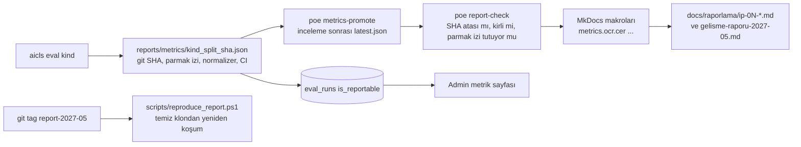

# İş Paketi Çıktıları → Depo Artefaktları

Bu tablo `tools/check_docs_map.py` tarafından CI'da doğrulanır: "Artefakt" sütunundaki her depo yolu (dosya ya da dizin) var olmalıdır; henüz yazılmamış sayfalar `(planlı: <faz>)` etiketiyle işaretlenir ve CI bunları atlar, ancak `report-YYYY-MM` etiketinde planlı etiketi kalmış satır CI'ı kırar. Dijital ekibin kapsamı dışındaki çıktılar (etik kurul, bursiyer, kitap yazımı, alan adı tescili) yalnızca "dış bağımlılık" olarak anılır.

## 1. Eşleme tablosu

| İP | Ara çıktı (öneri metni) | Artefakt | Ölçüm / kanıt |
|---|---|---|---|
| İP-1 | Alan adı tescil belgesi | dış bağımlılık (yürütücü) | `deploy/Caddyfile` alan adı |
| İP-1 | Sunucu konfigürasyon raporu | `docs/raporlama/ip-01-altyapi.md` (planlı: Faz 2) + `deploy/workstation/README.md` | kurulum betikleri, `poe env-check` çıktısı |
| İP-1 | Aktif SSL sertifikası | `deploy/Caddyfile` (TLS), `docs/guvenlik-gizlilik.md#4-ssl--taşıma` | `curl -I` başlık kanıtı |
| İP-1 | İhtiyaç analizi ve sistem gereksinimleri raporu | `docs/raporlama/ip-01-altyapi.md` (planlı) + `docs/mimari/genel-bakis.md` (veri akışı, topoloji) | |
| İP-2 | Arayüz Tasarım Dokümanı (tel çerçeve, maket) | `docs/mimari/arayuz-tasarimi.md` (planlı: Faz 1; Şekil 1–2 karşılığı maketler: "AI-CLS Arayüz Maketi" ve "AI-CLS Web Maketi" artefaktları) | |
| İP-2 | Frontend ve backend kod depoları (Git) | `web/`, `src/aicls/api/` | `README.md`, `CHANGELOG.md`, sürüm etiketleri |
| İP-2 | API dokümantasyonu | `docs/mimari/api.md` + `docs/api/openapi.json` (planlı: Faz 1, `scripts/export_openapi.py`) | CI `openapi-drift` |
| İP-2 | Fonksiyonel web prototipi | `v0.2.0` etiketi (Faz 2) | Playwright `e2e/browsers.spec.ts` |
| İP-2 | Test sonuç raporları | `docs/raporlama/ip-02-web.md` (planlı) ← Playwright JSON, `reports/metrics/latency_*.json`, `tests/perf/` | komut iletimi > %95 (`nlu_*.json` intent_accuracy), yanıt < 3 s (`latency_samples`), SUS > 75 (`sus_responses`) |
| İP-3 | Toplanan ve etiketlenen ses dosyaları | `AICLS_DATA_ROOT/audio/` (git dışı) + `datasets/manifests/audio_commands.json`, `audio_commands_splits.json` (planlı: Faz 2, etik onayı sonrası) | `GET /contribute/stats`, veri kartı |
| İP-3 | Eğitilmiş ve doğrulanmış OCR model dosyası | `model_versions` satırı + `AICLS_MODELS_ROOT/ocr-x.y.z/` (`run_manifest.json`, sha256) | `reports/metrics/ocr_test_*.json` CER < %10 |
| İP-3 | İnce ayarlı ASR model dosyası | `model_versions` + `AICLS_MODELS_ROOT/asr-x.y.z/` | `reports/metrics/asr_test_*.json` WER < %10 (konuşmacı-ayrık) |
| İP-3 | 2 teknik rapor (mimari, eğitim süreci, CER/WER) | `docs/raporlama/ip-03-yapay-zeka.md` (planlı) altında OCR model kartı + ASR model kartı; `docs/ml/egitim-altyapisi.md` | tablolar `reports/metrics/` makrolarıyla |
| İP-3 | Geliştirici dokümanları (modellerin kullanımı) | `docs/mimari/moduller.md` (ocr, asr), `docs/ml/egitim-altyapisi.md`, `docs/referans/` (mkdocstrings, planlı) | |
| İP-3 | Okuma senaryoları, 50 saat veri, 200+ saat artırma | `datasets/nlu/reading_scenarios.yaml`, `aicls.collect`, `aicls.asr.augment`, `docs/ml/veri-yonetimi.md` | manifest saat sayısı |
| İP-4 | Python tabanlı yazılım modülü (LaTeX → SymPy → LaTeX) | `src/aicls/latex2sympy/`, `src/aicls/mathengine/` (+ `src/aicls/nlu/` metin→komut) | `poe test` |
| İP-4 | Teknik rapor (ayrıştırma algoritmaları, eşleştirme kuralları) | `docs/mimari/latex-ayristirici.md`, `docs/mimari/metin-komut-katmani.md`, `docs/raporlama/ip-04-cas.md` (planlı) | eşleme tablosu `commands.yaml`/`grammar/commands.yaml`'dan üretilir |
| İP-4 | Test veri seti ve analiz raporu | `datasets/curriculum/` (kartlar, `problems.jsonl`, `FROZEN.sha256`), `datasets/latex/valid_inputs.jsonl` (planlı: Faz 1) | `reports/metrics/cas_curriculum_*.json` (> %99), `parser_valid_*.json` (> %99) |
| İP-8 | Yapılandırılmış ve etiketlenmiş sorgulanabilir veritabanı | `book_*` tabloları, `src/aicls/book/`, JSON-LD/Turtle dışa aktarım | `aicls book coverage` = 1.00 |
| İP-8 | Yazılım arayüzü ve dokümantasyonu | `/book/*` uçları (`docs/mimari/api.md#37-kitap-i̇p-8`), `docs/mimari/veri-modeli.md#5-kitap-içerik-şeması-json-ld--rdf` | |
| İP-8 | İşlevsel prototip (komutla anlık çağırma) | `web/src/features/book/`, `datasets/book/fetch_test.jsonl` (planlı: Faz 2) | `reports/metrics/book_fetch_*.json` > %95 |
| İP-9 | İşlevsellik/performans/güvenlik/tarayıcı uyumluluğu raporları | `docs/raporlama/ip-09-test-ve-geri-bildirim.md` (planlı: Faz 4) ← CI artefaktları, `tests/perf`, güvenlik kontrol listesi, Playwright matrisi | |
| İP-9 | Kullanıcı geri bildirimi analizi (SUS + mülakat) | `feedback`, `sus_responses` tabloları, `POST /feedback/sus`, `aicls.eval.metrics.sus_score` | SUS > 75, "kolay" ≥ %80 |
| İP-9 | Kararlı platform sürümü | `v1.0.0` etiketi | iki iyileştirme döngüsü CHANGELOG'da |

Kitap içeriği (İP-7) ve pedagojik değerlendirme (İP-10) bu ekibin kapsamı dışındadır; İP-8 örnek bölümle ilerler, tam içerik geldiğinde aynı yükleyici kullanılır.

## 2. Metriklerin gelişme raporuna akışı

1. Her `aicls eval` çıktısı git'e girer (küçük JSON); en kötü örnek listeleri yanına.
2. `poe metrics-promote <dosya>` PR ile `latest.json`'ı günceller; PR incelemesi sayının kaynağını (config, model sürümü, veri parmak izi) görür.
3. `poe report-check` CI'da: terfi edilmiş her dosyanın `git_sha`'sı HEAD'in atası, `dirty=false`, `citable=true`, parmak izi manifestle eşleşiyor, normalizer sürümleri güncel.
4. Rapor sayfaları sayıları `{{ metrics.<kind>.<metric> }}` makrolarıyla alır; dipnotta SHA, parmak izi, tarih. Elle yazılmış sayı yoktur; `tools/check_docs_map.py` rapor sayfalarında çıplak yüzde deseni bulursa uyarır.
5. `docs/raporlama/sonuclar.md` (`aicls report render`) sözleşme hedefi sütunuyla özet tablo; gelişme raporu taslağı bu tabloyu içerir.
6. Rapor teslimi öncesi `git tag report-2027-05` ve `scripts/reproduce_report.ps1` temiz klondan geçer; etiket `datasets/`, `reports/metrics/`, `models/registry.yaml`'ı dondurur.

## 3. 01.05.2027 gelişme raporunda gösterilebilecekler (kapı durumuna göre)

| Kapılardan bağımsız (Faz 1–2) | Kapılar açılırsa (Faz 3) |
|---|---|
| ayrıştırma başarısı (≥ 2000 girdi), CAS doğruluğu (1000 problem, konu kırılımı), NLU niyet/yuva doğruluğu (≥ 300 + gürültülü), kitap örnek bölümü kapsama/getirme, metin yolu gecikmesi (ortalama/p50/p95, istemci ölçümlü), WS iz/ses tur süresi (stub), tarayıcı uyumluluk matrisi, test/kapsam/CI istatistikleri, ADR listesi, toplanan saat/konuşmacı (etik onayı gelmişse), literatür notları | MathWriting test bölmesinde OCR CER (+GA, ön işleme ve çevrimiçi/çevrimdışı ablasyon tablosu), konuşmacı-ayrık iç test kümesinde ASR ham/tr_v1 WER ve komut niyet doğruluğu (toplanan saat kadar), gerçek modellerle uçtan uca gecikme, profil koşularından ölçülmüş adım hızları |

Rapor, hedefe ulaşılmamış metrikleri de aynı tabloda gösterir (hedef sütunu, ölçülen sütun, güven aralığı, veri boyutu); bu, İP-3 risk planındaki B planlarının (artırma, ensemble, komut kümesini daraltma) gerekçesini oluşturur.

## 4. Rapor sayfaları (docs/raporlama/)

| Sayfa | İçerik | Durum |
|---|---|---|
| `ip-eslestirme.md` | bu tablo | yazıldı |
| `ip-01-altyapi.md` | sunucu konfigürasyonu, SSL, ihtiyaç analizi | planlı: Faz 2 |
| `ip-02-web.md` | arayüz tasarımı özeti, API, test sonuçları, gecikme bütçesi | planlı: Faz 1 |
| `ip-03-yapay-zeka.md` | veri toplama protokolü, veri kartları, OCR/ASR model kartları | planlı: Faz 2/3 |
| `ip-04-cas.md` | ayrıştırıcı raporu, komut envanteri, test seti analizi | planlı: Faz 1 |
| `ip-08-kitap-entegrasyonu.md` | şema, kapsama, getirme doğruluğu | planlı: Faz 2 |
| `ip-09-test-ve-geri-bildirim.md` | test raporları, SUS, iki iyileştirme döngüsü | planlı: Faz 4 |
| `sonuclar.md` | otomatik metrik tablosu | üretilir |
| `gelisme-raporu-2027-05.md` | taslak; tabloları içerir | planlı: Faz 3 |
| `olcum-gunlugu.md` | her terfi edilmiş metrik için tarih/SHA/kim | planlı: Faz 1 |
